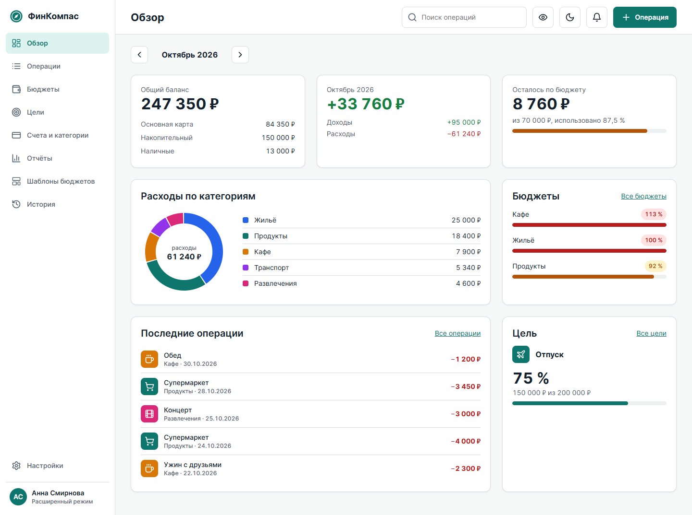

# ФинКомпас: проект интерфейса системы управления финансами

Лабораторная работа S2G11 «Проект интерфейса программной системы». Вариант: система управления финансами.

**Автор:** Быстряков Роман Константинович



## Что внутри

- Техническое задание с ролями и уровнями доступа.
- Аналитическое исследование: аудитория, персоны, конкуренты.
- 12 сценариев, UML Use-Case, 4 листа User Flow с экранами, User Flow Map на листе А4.
- 4 черновых прототипа, moodboard, 2 UI-кита.
- 12 экранов: 13 фреймов в светлой и тёмной темах.
- 102 векторных SVG, 102 PNG, 3 векторных PDF, включая единый отчёт.
- Токены, 57 значков, шрифт Inter, описание анимации и передачи в разработку.
- Рабочее приложение в `site/`: 54 автоматические проверки пройдены.

## Обязательные пункты задания

| Пункт | Где |
|---|---|
| Техническое задание | [docs/01-tech-spec.md](docs/01-tech-spec.md) |
| Исследование | [docs/02-research.md](docs/02-research.md) |
| Сценарии и Use-Case | [docs/03-user-scenarios.md](docs/03-user-scenarios.md) |
| User Flow и Flow Map | [docs/04-ia-userflow.md](docs/04-ia-userflow.md) |
| Прототипы | [docs/05-prototyping.md](docs/05-prototyping.md) |
| Moodboard и UI-киты | [docs/06-style-moodboard.md](docs/06-style-moodboard.md) |
| Экраны | [docs/07-screens.md](docs/07-screens.md) |
| Анимация | [docs/08-motion.md](docs/08-motion.md) |
| Материалы для разработчиков | [docs/09-handoff.md](docs/09-handoff.md) |
| Отчёт и сдача | [docs/10-report-and-delivery.md](docs/10-report-and-delivery.md) |
| Весь отчёт одним файлом | [docs/00-full-report.md](docs/00-full-report.md) |

Дополнительно: [доступность](docs/a11y.md), [контент](docs/content.md), [адаптивность](docs/responsive.md), [приложения](docs/11-appendix.md).

## Экраны

| Код | Экран | Светлая | Тёмная |
|---|---|---|---|
| S1 | Регистрация и авторизация | [SVG](design/export/svg/S1_Auth_Light.svg) | [SVG](design/export/svg/S1_Auth_Dark.svg) |
| S2 | Главный экран | [SVG](design/export/svg/S2_Overview_Light.svg) | [SVG](design/export/svg/S2_Overview_Dark.svg) |
| S3 | Настройки профиля | [SVG](design/export/svg/S3_Settings_Light.svg) | [SVG](design/export/svg/S3_Settings_Dark.svg) |
| S4 | Операции | [SVG](design/export/svg/S4_Transactions_Light.svg) | [SVG](design/export/svg/S4_Transactions_Dark.svg) |
| S5 | Бюджеты | [SVG](design/export/svg/S5_Budgets_Light.svg) | [SVG](design/export/svg/S5_Budgets_Dark.svg) |
| S6 | Отчёты и экспорт | [SVG](design/export/svg/S6_Reports_Light.svg) | [SVG](design/export/svg/S6_Reports_Dark.svg) |
| S7 | История действий | [SVG](design/export/svg/S7_History_Light.svg) | [SVG](design/export/svg/S7_History_Dark.svg) |
| S8 | Счета и категории | [SVG](design/export/svg/S8_Accounts_Light.svg) | [SVG](design/export/svg/S8_Accounts_Dark.svg) |
| S9 | Финансовые цели | [SVG](design/export/svg/S9_Goals_Light.svg) | [SVG](design/export/svg/S9_Goals_Dark.svg) |
| S10 | Смартфон, портрет | [SVG](design/export/svg/S10_Mobile_Portrait_Light.svg) | [SVG](design/export/svg/S10_Mobile_Portrait_Dark.svg) |
| S10 | Смартфон, альбомная | [SVG](design/export/svg/S10_Mobile_Landscape_Light.svg) | [SVG](design/export/svg/S10_Mobile_Landscape_Dark.svg) |
| S11 | Шаблоны бюджетов | [SVG](design/export/svg/S11_Templates_Light.svg) | [SVG](design/export/svg/S11_Templates_Dark.svg) |
| S12 | Администрирование | [SVG](design/export/svg/S12_Admin_Light.svg) | [SVG](design/export/svg/S12_Admin_Dark.svg) |

Всё сразу: [FinKompas_Otchet.pdf](design/export/FinKompas_Otchet.pdf), [FinKompas_Makety.pdf](design/export/FinKompas_Makety.pdf), [FinKompas_Diagrammy.pdf](design/export/FinKompas_Diagrammy.pdf).

## Приложение

Обычный HTML, CSS и JavaScript, без сборки и сервера. Откройте `site/index.html`, затем `site/login.html` и нажмите «Открыть демо с данными».

Работают: вход и регистрация, операции с отменой, импорт CSV и OFX, бюджеты и шаблоны, цели, счета и валюты, отчёты, экспорт CSV, XLSX и PDF, история с отменой, тёмная тема, скрытие сумм, простой и расширенный режимы, роль администратора, адаптивная вёрстка.

Данные хранятся только в браузере, вход и письма демонстрационные. Подробно: [границы прототипа](docs/11-appendix.md#границы-прототипа).

## Палитра

| Токен | Светлая | Тёмная |
|---|---|---|
| Акцент | `#0F766E` | `#2DD4BF` |
| Фон | `#F6F8F8` | `#0F1419` |
| Карточка | `#FFFFFF` | `#1A2129` |
| Доход | `#15803D` | `#4ADE80` |
| Расход | `#B91C1C` | `#F87171` |
| Предупреждение | `#B45309` | `#FBBF24` |

## Структура

```text
finkompas-ui/
├── docs/            отчёт по разделам
├── design/export/   SVG, PNG и PDF
├── tokens/          токены JSON и CSS
├── assets/          логотип, значки, шрифты
├── site/            рабочее приложение
└── tools/           генерация страниц, диаграмм, экспорт, тесты
```

## Как сделаны макеты

Макеты экспортированы из работающего приложения в SVG с настоящим текстом, поэтому суммы и состояния на них совпадают с поведением интерфейса. Те же SVG загружены в [файл Figma](https://www.figma.com/design/13cyrQG2Ir2gv4kGTFjgeG), его устройство описано в [docs/09-handoff.md](docs/09-handoff.md).

## Лицензии

Код и материалы: [MIT](LICENSE). Значки: [Lucide](https://lucide.dev), ISC. Шрифт: [Inter](https://rsms.me/inter/), SIL OFL 1.1.
