# Лабораторная работа S2G11 «Проект интерфейса программной системы»

**Вариант:** система управления финансами
**Продукт:** «ФинКомпас»
**Выполнил:** Быстряков Роман Константинович, группа [номер группы]
**Проверил:** [ФИО преподавателя]
**Репозиторий:** [ссылка на GitHub]

# 1. Техническое задание

**УТВЕРЖДАЮ**<br>
[Должность, кафедра]<br>
\_\_\_\_\_\_\_\_\_\_ / [ФИО преподавателя] /<br>
«\_\_» \_\_\_\_\_\_\_\_\_\_ 20\_\_ г.

**Техническое задание на разработку проекта интерфейса системы управления личными финансами «ФинКомпас»**

## Содержание

1. Общие сведения
2. Назначение и цели разработки
3. Требования к проекту интерфейса
4. Состав и содержание работ

## 1. Общие сведения

### 1.1. Наименование работы

Проектирование пользовательского интерфейса системы управления личными финансами «ФинКомпас».

### 1.2. Заказчик

[Кафедра, ФИО преподавателя].

### 1.3. Исполнитель

Быстряков Роман Константинович, группа [номер группы].

### 1.4. Основание для проведения работ

Учебный план дисциплины, задание на лабораторную работу S2G11 «Проект интерфейса программной системы», вариант «Система управления финансами».

### 1.5. Сроки выполнения работ

Начало: [дата]. Окончание: [дата].

### 1.6. Источники финансирования

Не предусмотрены, работа учебная.

### 1.7. Порядок предъявления результатов

Исполнитель предъявляет макеты в файле Figma и в векторном формате (SVG и PDF), отчёт в векторном PDF и репозиторий GitHub с поэтапной историей коммитов.

## 2. Назначение и цели разработки

«ФинКомпас» помогает частному пользователю вести учёт доходов и расходов, планировать бюджет, копить на цели и понимать структуру трат.

Цели разработки интерфейса:

- показать финансовое состояние на одном экране;
- сократить ввод операции до нескольких действий, чтобы учёт не бросали через неделю;
- предупреждать о приближении к лимиту до его превышения;
- превращать данные в понятные выводы с помощью графиков и отчётов;
- вызывать доверие: защищать данные и не скрывать, что с ними происходит.

Проект охватывает интерфейс. Серверная часть, подключение к банкам и проведение платежей в работу не входят: система учитывает деньги, но не переводит их.

## 3. Требования к проекту интерфейса

### 3.1. Общие требования

Виды работ:

1. Разработка технического задания.
2. Исследование аудитории и конкурентов.
3. Пользовательские сценарии, UML Use-Case диаграмма.
4. Структура: User Flow и User Flow Map.
5. Черновой и финальный прототипы.
6. Стилистика: варианты moodboard, UI-киты светлой и тёмной тем.
7. Оформление экранов для настольного компьютера, ноутбука, планшета и смартфона.
8. Анимация.
9. Материалы для разработчиков.
10. Отчёт.

Интерфейс рассчитан на актуальные версии браузеров Google Chrome, Microsoft Edge, Mozilla Firefox и Apple Safari в операционных системах Windows, macOS, Linux, Android и iOS.

### 3.2. Требования к экранам

Заданием требуется не менее 8 экранов, в проекте их 12:

| Код | Экран |
|---|---|
| S1 | Регистрация и авторизация |
| S2 | Главный экран (обзор финансов) |
| S3 | Настройки профиля |
| S4 | Операции |
| S5 | Бюджеты |
| S6 | Отчёты и экспорт |
| S7 | История действий |
| S8 | Счета и категории |
| S9 | Финансовые цели |
| S10 | Смартфон, портрет и альбомная ориентация |
| S11 | Шаблоны бюджетов |
| S12 | Администрирование |

### 3.3. Требования к дизайну

- Интерфейс работает на настольных компьютерах, ноутбуках, планшетах и смартфонах.
- Максимальное расчётное разрешение 1920 px по ширине, минимальное для настольного представления 1024 px. Горизонтальной прокрутки страницы нет.
- Интерфейс поддерживает управление касанием: зоны нажатия не меньше 44×44 px, действия не зависят от наведения курсора.
- При недоступности функций браузера интерфейс деградирует плавно: данные и основные действия остаются доступны без анимации и при отключённых графических эффектах.
- Единая система токенов: цвет, типографика, отступы, радиусы (`tokens/tokens.json`).
- Два UI-кита: светлый и тёмный.
- Сетка с шагом 8 px, 12 колонок на настольном представлении.
- Контраст обычного текста не ниже 4.5:1, крупного текста и элементов интерфейса не ниже 3:1 (WCAG 2.1, AA).
- Цвет не единственный носитель смысла: доход и расход различаются знаком «+» и «−», превышение лимита подписано текстом.
- Суммы набираются табличными цифрами, чтобы разряды в столбцах совпадали.

### 3.4. Требования к интерфейсу

- Язык интерфейса русский.
- Пользователи не обязаны иметь технической или финансовой подготовки: термины заменены понятными словами, простой режим скрывает лишние функции.
- Контекст использования: быстрая запись траты на смартфоне сразу после покупки, разбор месяца и планирование на компьютере.
- Операция добавляется с любого экрана: кнопка в верхней панели, круглая кнопка на смартфоне.
- До любого раздела не более двух переходов.
- Опасные действия требуют подтверждения. Удалённую операцию можно вернуть.
- Экраны имеют состояния: пусто, ошибка, данные.
- Суммы скрываются одной кнопкой.
- Рубль и иностранные валюты, общий баланс пересчитывается по указанному курсу.

### 3.5. Требования к смартфонному представлению

- Базовая ширина макета 390 px, минимальная поддерживаемая 360 px.
- Боковое меню заменяется нижней панелью из 5 пунктов.
- Минимальная зона нажатия 44×44 px.
- Таблицы превращаются в списки карточек.
- Диалоги открываются нижним листом.
- Основные действия находятся внизу, в зоне досягаемости большого пальца.

### 3.6. Ролевая модель

| Функция | Новичок | Продвинутый пользователь | Администратор |
|---|---|---|---|
| Обзор финансов | Да | Да | Нет |
| Операции | Да | Да | Нет |
| Счета и категории | Встроенные категории | Свои категории | Нет |
| Бюджеты | Один общий бюджет | По категориям, перенос остатка | Нет |
| Финансовые цели | Да | Да | Нет |
| Регулярные операции | Нет | Да | Нет |
| Импорт выписок CSV и OFX | Нет | Да | Нет |
| Отчёты | Базовые | Все отчёты и сравнение периодов | Нет |
| Экспорт | PDF | PDF, CSV, XLSX | Нет |
| История действий | Свои действия | Свои действия | Системный журнал без финансовых данных |
| Управление пользователями | Нет | Нет | Блокировка, сброс 2FA |

Администратор намеренно не видит суммы и операции пользователей: поддержке эти данные не нужны.

### 3.7. Уровни доступа

| Уровень | Кто | Возможности |
|---|---|---|
| L0, гость | Незарегистрированный посетитель | Страница входа, регистрация, восстановление пароля |
| L1, базовый | Новичок | Учёт в простом режиме, общий бюджет, базовые отчёты, экспорт в PDF |
| L2, расширенный | Продвинутый пользователь | Всё из L1, а также импорт, регулярные операции, бюджеты по категориям, все отчёты, CSV и XLSX |
| L3, административный | Администратор | Учётные записи и системный журнал. Вход с двухфакторной аутентификацией |

## 4. Состав и содержание работ

| Этап | Содержание | Результат |
|---|---|---|
| 1 | Составление ТЗ | [01-tech-spec.md](01-tech-spec.md) |
| 2 | Исследование | [02-research.md](02-research.md) |
| 3 | Сценарии | [03-user-scenarios.md](03-user-scenarios.md), UML |
| 4 | Структура | [04-ia-userflow.md](04-ia-userflow.md), 4 листа User Flow, Flow Map |
| 5 | Прототипирование | [05-prototyping.md](05-prototyping.md), черновые и финальные прототипы всех экранов |
| 6 | Стилистика | [06-style-moodboard.md](06-style-moodboard.md), 3 варианта moodboard, 2 UI-кита |
| 7 | Оформление | [07-screens.md](07-screens.md), 13 фреймов экранов, планшет и состояния в 2 темах |
| 8 | Анимация | [08-motion.md](08-motion.md) |
| 9 | Передача в разработку | [09-handoff.md](09-handoff.md), токены, значки, спрайт, шрифты |
| 10 | Отчёт | [10-report-and-delivery.md](10-report-and-delivery.md), PDF, репозиторий |

# 2. Исследование

Исследование аналитическое: опросы и интервью не проводились, сведения о продуктах собраны из общедоступных описаний. Перед разработкой реального продукта гипотезы нужно проверить на пользователях.

## 2.1. Целевая аудитория

| Сегмент | Портрет | Цели | Боли | Вывод для интерфейса |
|---|---|---|---|---|
| Студенты и молодые специалисты, 18–25 лет | Стипендия, подработка, почти всё на смартфоне | Дотянуть до конца месяца, накопить на покупку | Не понимают, куда уходят деньги, быстро бросают учёт | Быстрый ввод, простой язык, мобильная версия |
| Работающие взрослые, 26–45 лет | Несколько счетов, кредит или ипотека, семейные расходы | Контроль бюджета, отпуск, подушка безопасности | Данные разбросаны по банкам, ручной ввод отнимает время | Импорт выписок, бюджеты по категориям, регулярные платежи |
| Самозанятые, 25–50 лет | Нерегулярный доход, личные и рабочие деньги смешаны | Планировать при плавающем доходе | Трудно оценить реальный доход за период | Отчёт «Доходы и расходы», экспорт в таблицы |

## 2.2. Персоны

**Анна, 24 года, новичок.** Младший аналитик, живёт одна, снимает квартиру. Хочет понимать, сколько можно потратить до зарплаты, и накопить на отпуск. Таблицы вела две недели и бросила. Ей нужен простой режим и быстрый ввод.

**Дмитрий, 38 лет, продвинутый пользователь.** Инженер, две карты и накопительный счёт. Раз в месяц сверяет выписки, сравнивает месяцы, следит за лимитами по категориям. Ему нужны импорт, регулярные платежи, CSV и XLSX.

**Елена, 31 год, администратор.** Сотрудник поддержки. Блокирует учётные записи и сбрасывает двухфакторную защиту по обращениям, читает системный журнал. Финансовые данные пользователей ей не нужны и не показываются.

## 2.3. Анализ конкурентов

| Продукт | Достоинства | Недостатки |
|---|---|---|
| Дзен-мани | Импорт из банков, подробная аналитика, совместный учёт | Высокий порог входа, перегруженные настройки |
| CoinKeeper | Простая модель, перетаскивание монет между категориями | Перетаскивание неудобно при большом числе операций, слабее аналитика |
| Monefy | Очень быстрый ввод, минимальный интерфейс | Мало аналитики и планирования |
| YNAB | Сильная методика бюджета, обучение | Сложен для новичка, платный, ориентирован на англоязычную аудиторию |
| Excel и Google Таблицы | Полная гибкость, бесплатные шаблоны | Всё настраивается вручную, неудобно на смартфоне, легко сломать формулы |

Оценка экспертная. Перед сдачей стоит открыть актуальные версии приложений и приложить снимки экрана.

## 2.4. Выводы для интерфейса

1. **Скорость как у Monefy.** Операция добавляется в три действия: сумма, категория, сохранить.
2. **Глубина открывается постепенно.** Новичок работает в простом режиме, расширенные функции не мешают ему и включаются в настройках.
3. **Обзор отвечает на главный вопрос.** На первом экране есть остаток по бюджету: сколько ещё можно потратить.
4. **Предупреждения заранее.** Система показывает приближение к лимиту при расходовании 80 %, а не только факт превышения.
5. **Выход данных открыт.** Экспорт в CSV и XLSX снимает страх потерять историю и закрывает потребности тех, кто привык к таблицам.

## 2.5. Анализ устройств и ограничения

| Устройство | Когда используют | Что это значит для интерфейса |
|---|---|---|
| Смартфон | Сразу после покупки, на ходу, часто одной рукой | Запись операции внизу экрана, крупные зоны нажатия, нижняя панель |
| Планшет | Спокойный просмотр итогов дома | Те же данные, что на компьютере, управление касанием, колонки перестраиваются |
| Ноутбук и компьютер | Разбор месяца, импорт выписки, настройка бюджетов | Таблицы, фильтры, графики рядом, работа с клавиатуры |

Ограничения проекта:

- суммы и операции видны окружающим, поэтому есть скрытие сумм одной кнопкой;
- на смартфоне мало места для таблиц, поэтому они превращаются в списки карточек;
- на улице экран хуже читается, поэтому контраст текста держится на уровне AA и есть тёмная тема;
- значки без подписи понятны не всем новичкам, поэтому пункты меню подписаны.

Таблица составлена аналитически, без опроса пользователей и без статистики использования.

# 3. Пользовательские сценарии

## 3.1. Список задач

| № | Задача | Роль | Экран |
|---|---|---|---|
| 1 | Регистрация и первичная настройка | Гость | S1 |
| 2 | Добавление операции | Новичок | S2, S4 |
| 3 | Создание счёта | Новичок | S8 |
| 4 | Импорт банковской выписки | Продвинутый | S4 |
| 5 | Настройка бюджета | Продвинутый | S5 |
| 6 | Применение шаблона бюджета | Новичок | S11 |
| 7 | Создание и пополнение цели | Новичок | S9 |
| 8 | Просмотр и экспорт отчёта | Продвинутый | S6 |
| 9 | Отмена ошибочного действия | Новичок | S7 |
| 10 | Смена темы и режима | Новичок | S3 |
| 11 | Завершение чужого сеанса | Новичок | S3, S7 |
| 12 | Блокировка учётной записи | Администратор | S12 |

## 3.2. Описание по шагам

**Задача 1. Регистрация и первичная настройка**

1. Открыть приложение, выбрать вкладку «Регистрация».
2. Ввести имя, email и пароль, принять условия обработки данных.
3. Ввести код подтверждения.
4. Выбрать валюту и режим: простой или расширенный.
5. Указать остаток первого счёта.
6. Попасть на обзор с пустым состоянием и кнопкой «Добавить первую операцию».

**Задача 2. Добавление операции**

1. Нажать «Операция».
2. Выбрать тип: расход, доход или перевод. По умолчанию выбран расход.
3. Ввести сумму.
4. Выбрать категорию.
5. При необходимости изменить счёт и дату, добавить комментарий.
6. Нажать «Сохранить». Появится уведомление с кнопкой «Отменить», баланс и бюджет обновятся.

**Задача 3. Создание счёта**

1. Открыть «Счета и категории».
2. Нажать кнопку добавления счёта.
3. Указать название, валюту и начальный остаток.
4. Сохранить. Счёт появится в списке.

**Задача 4. Импорт банковской выписки**

1. Открыть «Операции», нажать «Импорт».
2. Выбрать файл CSV или OFX.
3. Выбрать счёт.
4. Сопоставить колонки файла с полями системы.
5. Проверить предпросмотр: строки отмечены как новые, дубликаты или ошибки.
6. Нажать «Импортировать» и увидеть итог: сколько добавлено и сколько пропущено.

**Задача 5. Настройка бюджета**

1. Открыть «Бюджеты», выбрать месяц.
2. Нажать кнопку настройки.
3. Задать лимиты по категориям.
4. Выбрать порог уведомления, по умолчанию 80 %.
5. Нажать «Сохранить бюджет» и увидеть прогресс по категориям.

**Задача 6. Применение шаблона бюджета**

1. Открыть «Шаблоны бюджетов».
2. Выбрать шаблон и нажать «Использовать».
3. Указать месячный доход.
4. Нажать «Применить». Система рассчитает лимиты и откроет бюджет.

**Задача 7. Создание и пополнение цели**

1. Открыть «Цели», нажать кнопку создания.
2. Ввести название, сумму и срок.
3. Система рассчитает ежемесячный взнос.
4. Нажать «Пополнить» и ввести сумму.

**Задача 8. Просмотр и экспорт отчёта**

1. Открыть «Отчёты».
2. Выбрать вкладку и период.
3. Изучить график и итоги.
4. Нажать кнопку экспорта, выбрать PDF, CSV или XLSX.
5. Получить файл. PDF сохраняется через печать браузера.

**Задача 9. Отмена ошибочного действия**

1. Открыть «История».
2. Найти событие с помощью фильтра.
3. Посмотреть блок «Было» и «Стало».
4. Нажать кнопку отмены и подтвердить.
5. Данные вернутся, в истории появится новая запись.

**Задача 10. Смена темы и режима**

1. Открыть «Настройки», раздел «Оформление».
2. Выбрать тему и режим. Изменения применяются сразу.

**Задача 11. Завершение чужого сеанса**

1. В разделе безопасности найти незнакомое устройство в списке активных.
2. Нажать «Завершить сеанс» или кнопку «Это был не я» в истории.
3. Сменить пароль.

**Задача 12. Блокировка учётной записи**

1. Войти как администратор. Обзор финансов недоступен, открывается раздел администрирования.
2. Найти пользователя в таблице.
3. Нажать кнопку блокировки. В системном журнале появится запись.

## 3.3. Сокращение длинных путей

После описания сценариев длинные маршруты проверены на лишние шаги.

| Задача | Длинный путь | Как сокращён |
|---|---|---|
| Записать трату | Открыть раздел «Операции», нажать «Добавить», заполнить все поля | Кнопка «Операция» на любом экране. Счёт и дата подставлены, остаются сумма и категория |
| Повторить платёж | Каждый месяц вводить операцию заново | Флажок «Повторять каждый месяц» в форме |
| Настроить бюджет | Задавать лимит каждой категории вручную | Шаблон рассчитывает лимиты от дохода |
| Узнать остаток | Перейти в «Бюджеты» и посчитать | Остаток показан в карточке на главном экране |
| Загрузить выписку | Вводить операции по одной | Импорт файла: колонки сопоставляются один раз, дубликаты отсеиваются |
| Исправить ошибку | Найти операцию и удалить её | Кнопка «Отменить» в уведомлении сразу после сохранения |

## 3.4. UML Use-Case диаграмма

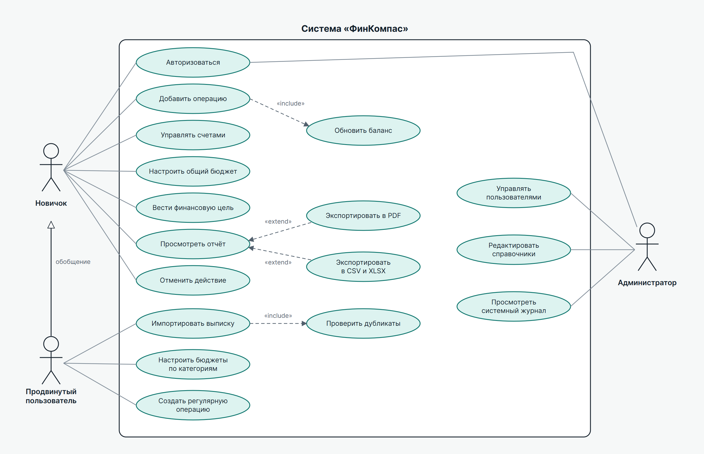

Вектор: [UML_UseCase.svg](../design/export/svg/UML_UseCase.svg). Обобщение показывает, что продвинутый пользователь наследует всё, что доступно новичку.

# 4. Структура интерфейса

## 4.1. Информационная архитектура

```text
Вход и регистрация (S1)
└── Обзор (S2)
    ├── Операции (S4)
    │   ├── Форма операции
    │   ├── Импорт выписки
    │   └── Регулярные платежи
    ├── Бюджеты (S5)
    ├── Цели (S9)
    ├── Счета и категории (S8)
    ├── Отчёты (S6)
    │   └── Экспорт
    ├── Шаблоны бюджетов (S11)
    ├── История (S7)
    └── Настройки (S3)

Администрирование (S12): отдельная ветка для роли администратора
```

## 4.2. User Flow ключевых сценариев

Каждый лист посвящён одному полезному действию. Экраны идут в одном направлении, обратных стрелок нет: ветка с ошибкой возвращается в основной поток дальше по ходу. Схемы монохромные, смысл передаёт форма, а красным выделены только ошибки. Легенда: круг обозначает вход и цель, прямоугольник экран, овал действие, ромб развилку.

Вариант с экранами: на листах показаны уменьшенные финальные прототипы, чтобы путь был виден вместе с интерфейсом.

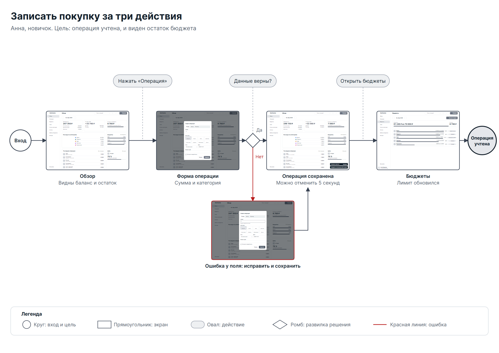

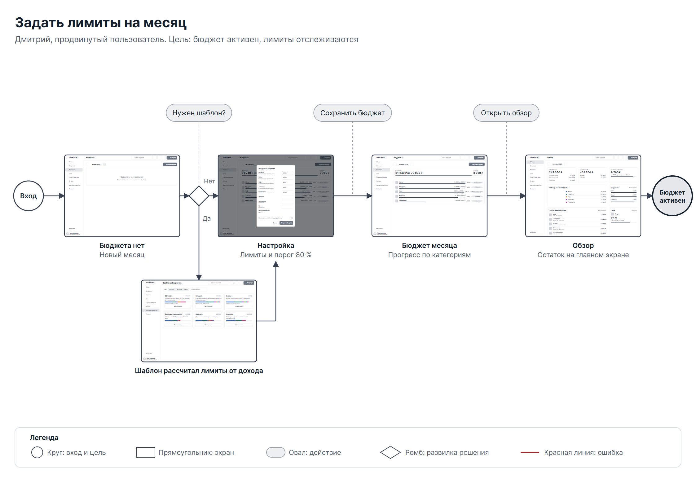

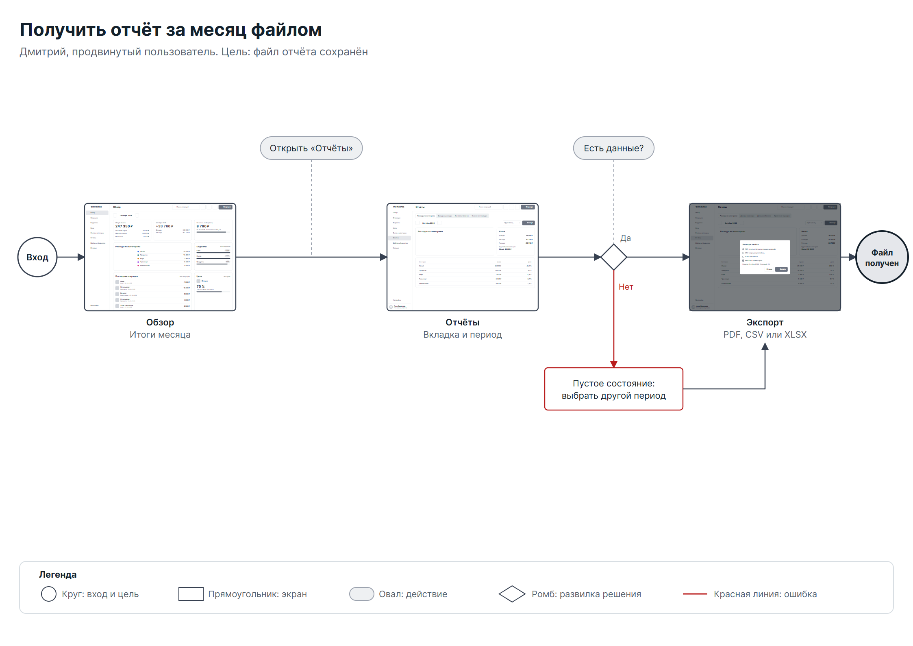

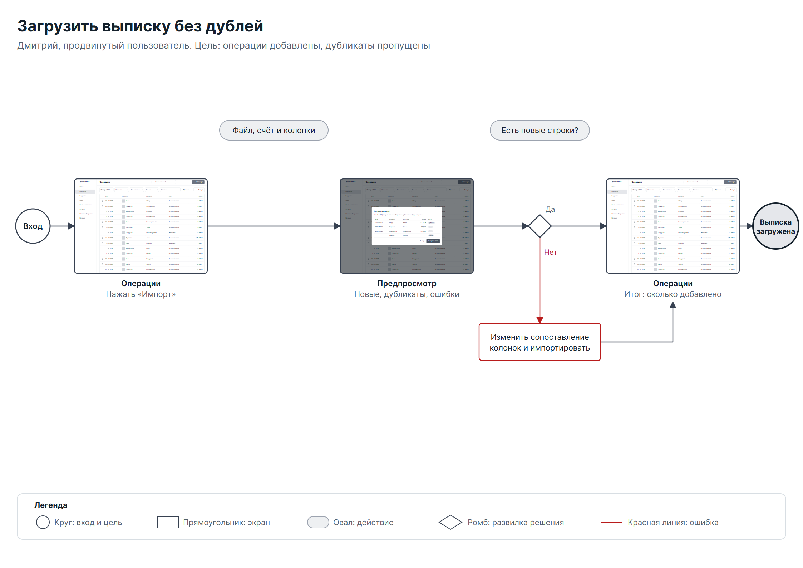

## 4.3. User Flow Map всего приложения

Карта связывает отдельные User Flow навигацией в один комплект на листе А4.

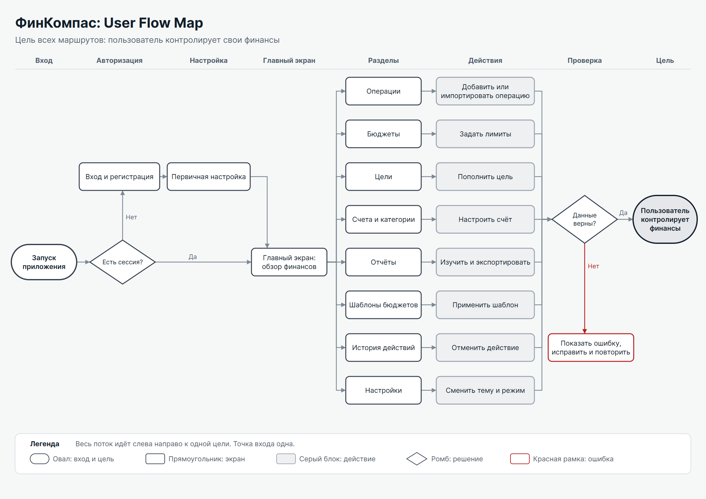

Лист А4, альбомная ориентация: [FinKompas_Diagrammy.pdf](../design/export/FinKompas_Diagrammy.pdf).

| № | Элемент | Реализация |
|---|---|---|
| 1 | Название | Заголовок листа: «ФинКомпас: User Flow Map» |
| 2 | Одно направление | Поток идёт слева направо |
| 3 | Одна цель | Единственная финальная точка: «Пользователь контролирует финансы» |
| 4 | Легенда | Внизу листа, по форме блоков: овал, прямоугольник, серый блок, ромб, красная рамка |
| 5 | Точка входа | Единственная точка слева: «Запуск приложения» |
| 6 | Подписи | Каждый блок подписан, ветвления отмечены «Да» и «Нет» |
| 7 | Цвета | Монохром, как рекомендует методичка. Красный только у ошибок |
| 8 | Проверка цели | Из каждого блока можно пройти к цели, тупиков нет |

# 5. Прототипирование

## 5.1. Черновой прототип

Черновые прототипы показывают зоны с подписями, без цвета, значков и текста. Они сделаны для всех 13 фреймов и лежат в файлах `design/export/svg/Wireframe_*.svg`. Описание зон дано в таблице ниже, сами схемы вошли в отчёт и в [FinKompas_Makety.pdf](../design/export/FinKompas_Makety.pdf).

Каркас desktop:

```text
+----------+------------------------------------------------+
|          | Верхняя панель: заголовок, поиск, «+ Операция» |
| Боковое  +------------------------------------------------+
| меню     |                                                |
| 240 px   |          Рабочая область (12 колонок)          |
|          |                                                |
+----------+------------------------------------------------+
```

Зоны экранов:

| Экран | Зоны |
|---|---|
| S1 | Блок описания продукта, форма |
| S2 | Три сводные карточки, диаграмма и бюджеты, операции и цель |
| S3 | Меню разделов, форма раздела |
| S4 | Фильтры, таблица, регулярные платежи |
| S5 | Переключатель месяца, сводка, категории |
| S6 | Вкладки, график, итоги, таблица |
| S7 | Фильтры, лента событий, детали |
| S8 | Вкладки, счета, категории |
| S9 | Сетка карточек целей |
| S10 | Заголовок, сводные карточки, список, нижняя панель с круглой кнопкой |
| S11 | Поиск, карточки шаблонов |
| S12 | Таблица пользователей, журнал |

## 5.2. Финальный прототип

Финальная схема содержит все элементы и тексты, но не содержит цвета, значков и изображений: файлы `design/export/svg/Prototype_*.svg`, 13 экранов и 10 состояний.

Интерактивный прототип работает в браузере: откройте `site/login.html` и нажмите «Открыть демо с данными». Все ссылки, формы и диалоги настоящие, данные хранятся в `localStorage`.

| Зона | Элементы |
|---|---|
| Боковое меню | Логотип, разделы, настройки, карточка пользователя |
| Верхняя панель | Заголовок, поиск, скрытие сумм, тема, уведомления, кнопка «Операция» |
| Форма операции | Тип, сумма, категория, счёт, дата, комментарий |
| Фильтры | Период, счёт, категория, тип, описание, «Сбросить» |
| Настройка бюджета | Лимиты, порог уведомления, перенос остатка |
| Экспорт | Формат, включение комментариев |

## 5.3. Проверка переходов

Переходы и формы проверяет `tools/test-app.mjs` в настоящем браузере: 54 проверки, включая авторизацию, расчёты, импорт, отмену, роли и ширины 360, 1024 и 1920 px. Это автоматическая проверка логики, а не юзабилити-тест с людьми.

# 6. Стилистика

## 6.1. Moodboard

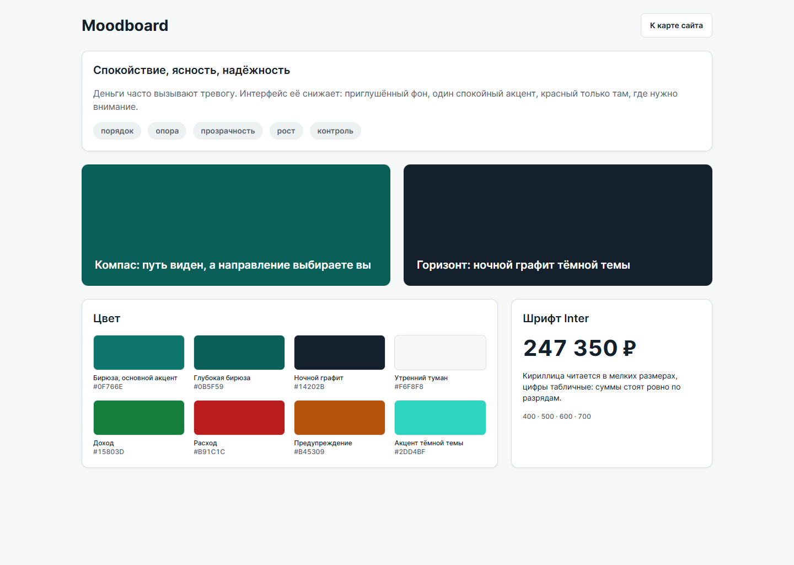

**Настроение:** спокойствие, ясность, надёжность. Деньги и так вызывают тревогу, поэтому красный используется только там, где нужно внимание.

**Ключевые слова:** порядок, опора, прозрачность, рост, контроль.

**Метафора:** компас. Он не идёт за пользователя, но показывает, где тот находится и куда двигаться.

### Сравнение вариантов

Рассмотрено три набора:

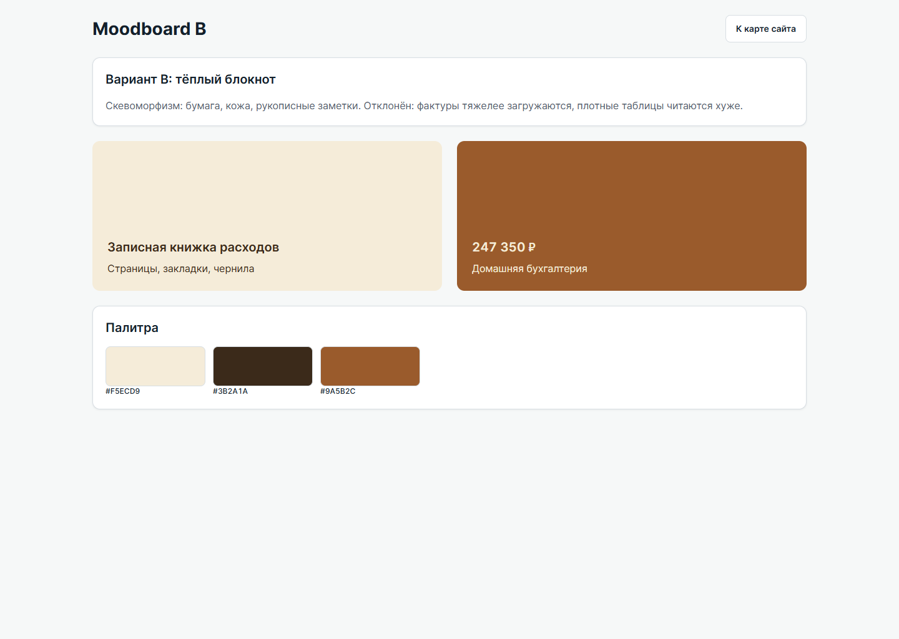

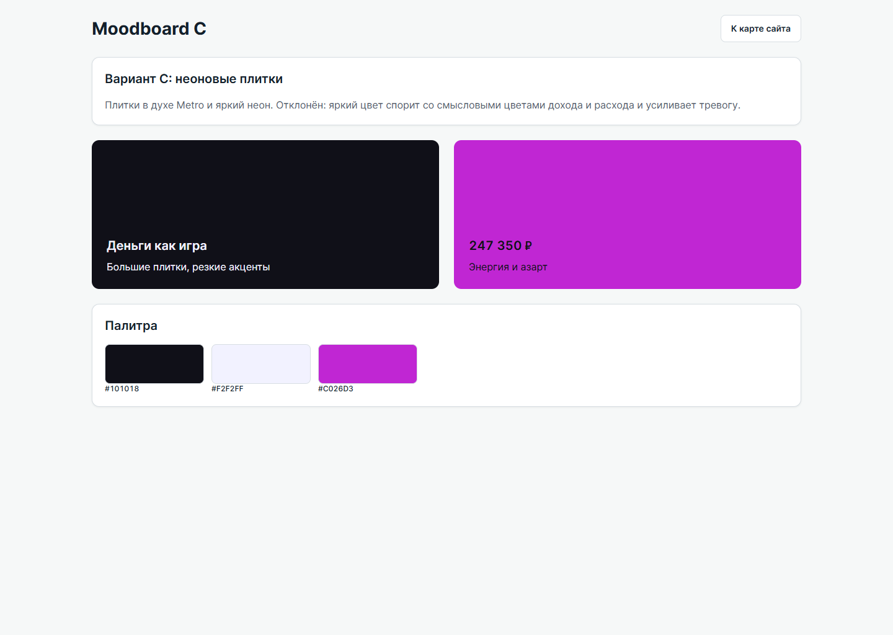

| Вариант | Стиль | Решение |
|---|---|---|
| A, компас | Плоский, близок к Material: поверхности, мягкие тени, сетка 8 px | Выбран: плотные таблицы читаются легко, цвет работает только на смысл |
| B, блокнот | Скевоморфизм: бумага, кожа | Отклонён: фактуры мешают данным и дороже в загрузке |
| C, плитки | Metro: большие плитки, неон | Отклонён: яркий акцент спорит с цветами дохода и расхода |

### Гармония цвета

Схема контрастная: глубокий бирюзовый акцент и красный лежат на круге Иттена почти напротив друг друга. Поэтому расход сразу заметен на спокойном фоне, а основную часть экрана занимают нейтральные серые тона.

## 6.2. Типографика

Шрифт Inter: есть кириллица, хорошая читаемость в мелких размерах, табличные цифры.

| Стиль | Размер / межстрочный | Насыщенность | Применение |
|---|---|---|---|
| Display | 40 / 48 | 700 | Общий баланс |
| H1 | 28 / 36 | 700 | Заголовок раздела |
| H2 | 20 / 28 | 600 | Заголовок карточки |
| Body | 16 / 24 | 400 | Основной текст |
| Body Small | 14 / 20 | 400 | Таблицы, подписи |
| Caption | 12 / 16 | 500 | Метки графиков |

## 6.3. Токены цвета

| Токен | Светлая | Тёмная | Назначение |
|---|---|---|---|
| `bg/page` | `#F6F8F8` | `#0F1419` | Фон страницы |
| `bg/surface` | `#FFFFFF` | `#1A2129` | Карточки, панели |
| `bg/muted` | `#EDF1F2` | `#242D37` | Приглушённый фон |
| `border/default` | `#D8DEE3` | `#2E3843` | Границы |
| `text/primary` | `#14202B` | `#E6EDF3` | Основной текст |
| `text/secondary` | `#52606D` | `#9FB0C0` | Вторичный текст |
| `accent/primary` | `#0F766E` | `#2DD4BF` | Основные действия |
| `accent/on-primary` | `#FFFFFF` | `#0F1419` | Текст на акцентной кнопке |
| `state/income` | `#15803D` | `#4ADE80` | Доход |
| `state/expense` | `#B91C1C` | `#F87171` | Расход, ошибка |
| `state/warning` | `#B45309` | `#FBBF24` | Приближение к лимиту |
| `state/info` | `#1D4ED8` | `#60A5FA` | Информация |

Полный набор: [tokens.json](../tokens/tokens.json), [tokens.css](../tokens/tokens.css).

## 6.4. UI-киты

| Светлый | Тёмный |
|---|---|
| 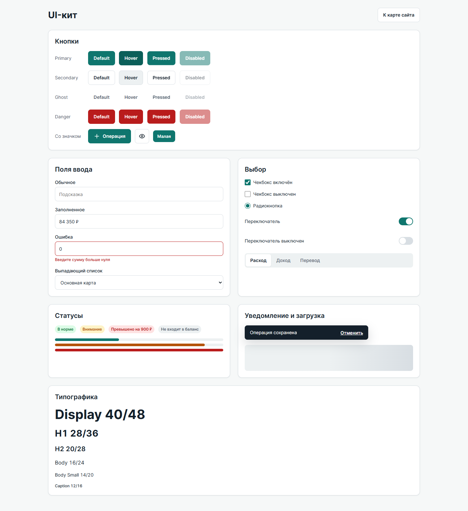 | 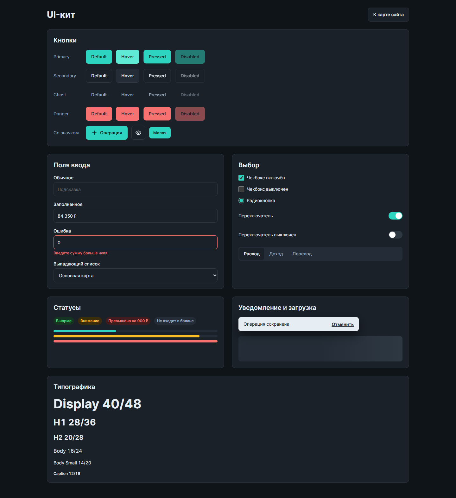 |

Параметры: радиус карточек 12 px, кнопок и полей 8 px, высота кнопок и полей 44 px, значки Lucide.

| Группа | Компоненты | Состояния |
|---|---|---|
| Кнопки | Primary, Secondary, Ghost, Danger, со значком | Default, Hover, Pressed, Disabled |
| Поля | Текст, сумма, выпадающий список | Обычное, заполненное, ошибка |
| Выбор | Чекбокс, радиокнопка, переключатель, сегменты | Включено, выключено |
| Статусы | Бейджи, шкалы прогресса | В норме, внимание, превышено |
| Обратная связь | Уведомление, скелетон | Успех, загрузка |

## 6.5. Тёмная тема

Зачем она финансовой системе:

- учёт часто ведут вечером, тёмный фон меньше утомляет глаза;
- на OLED-экранах тёмный интерфейс расходует меньше заряда;
- яркий экран в общественном месте привлекает внимание к личным данным.

Как устроена:

- глубина передаётся осветлением поверхности: страница `#0F1419`, карточка `#1A2129`;
- вместо чистых чёрного и белого используются смягчённые тона;
- смысловые цвета осветлены и остаются контрастными;
- на акцентной кнопке тёмный текст.

Тема переключается одной кнопкой в верхней панели и в настройках. Значения контраста приведены в [a11y.md](a11y.md).

# 7. Оформление экранов

Данные едины для всех экранов и согласованы по суммам. Период: октябрь 2026. Каждый экран есть в светлой и тёмной темах: `design/export/svg/<код>_Light.svg` и `<код>_Dark.svg`.

## S1. Регистрация и авторизация

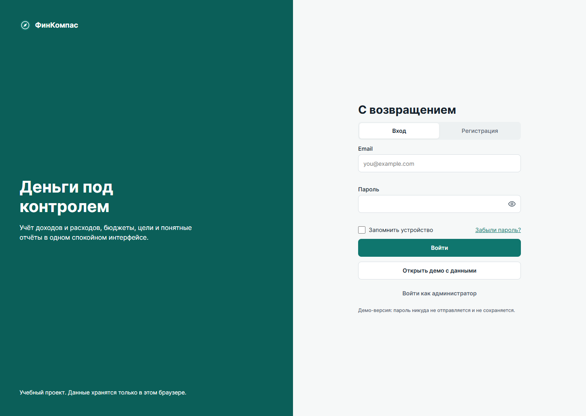

**Назначение:** вход и создание учётной записи.

**Элементы:** логотип и слоган «Деньги под контролем», вкладки «Вход» и «Регистрация», поля имени, email и пароля, индикатор надёжности пароля, «Запомнить устройство», согласие на обработку данных, «Забыли пароль?», вход в демо-версию и вход администратора.

**Функционал:** проверка полей, подтверждение кодом из 6 цифр, первичная настройка валюты, режима и остатка. Форма демонстрационная: пароль никуда не отправляется.

**Адаптивность:** на смартфоне блок описания скрыт, остаются логотип и форма.

## S2. Главный экран

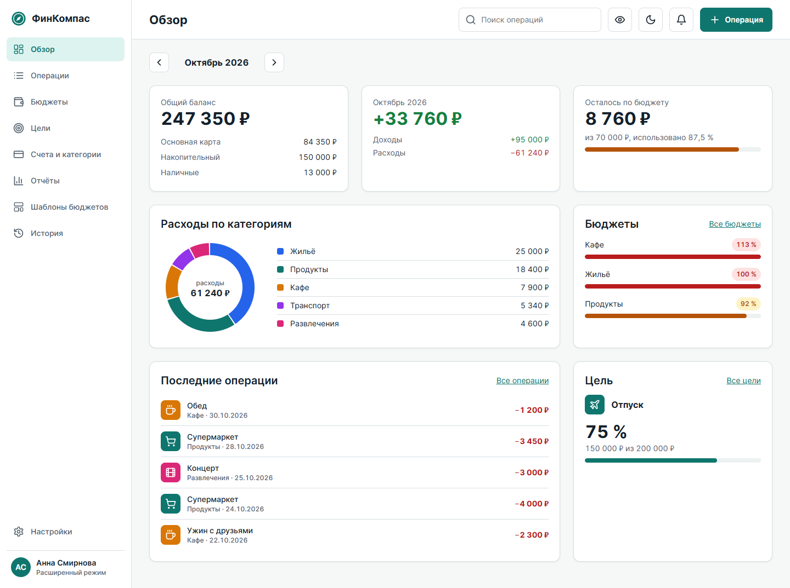

**Назначение:** показать финансовое состояние.

**Элементы:** общий баланс 247 350 ₽ со списком счетов; октябрь: доходы +95 000 ₽, расходы −61 240 ₽, разница +33 760 ₽; остаток бюджета 8 760 ₽ из 70 000 ₽, использовано 87,5 %; кольцевая диаграмма расходов; три бюджета, ближайшие к лимиту; пять последних операций; цель «Отпуск», 75 %.

**Функционал:** скрытие сумм, переключение месяца, пустое состояние с кнопкой «Добавить первую операцию».

**Адаптивность:** tablet: 8 колонок. Смартфон: одна колонка.

## S3. Настройки профиля

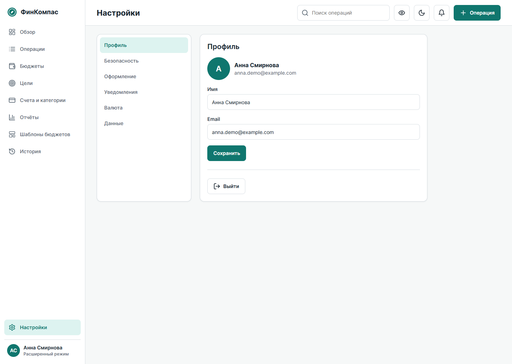

**Элементы:** профиль, безопасность (смена пароля, двухфакторная аутентификация, активные устройства), оформление (тема и режим), валюта с постоянными демо-курсами, данные (возврат демо-данных, удаление аккаунта).

**Функционал:** тема и режим применяются сразу. Удаление аккаунта требует подтверждения.

## S4. Операции

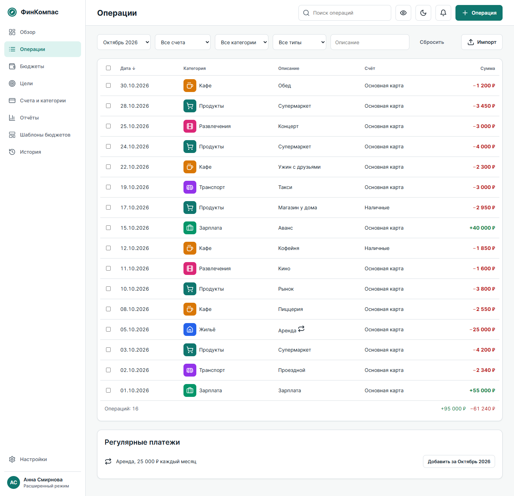

**Элементы:** фильтры по периоду, счёту, категории, типу и описанию, «Сбросить», «Импорт», таблица с датой, категорией, описанием, счётом и суммой, итог, регулярные платежи.

**Функционал:** сортировка, выбор строк, изменение категории и удаление нескольких операций, отмена через уведомление 5 секунд. Импорт идёт в 4 шага: файл CSV или OFX, счёт, сопоставление колонок, предпросмотр с дубликатами и ошибками.

**Адаптивность:** на смартфоне таблица становится списком карточек.

## S5. Бюджеты

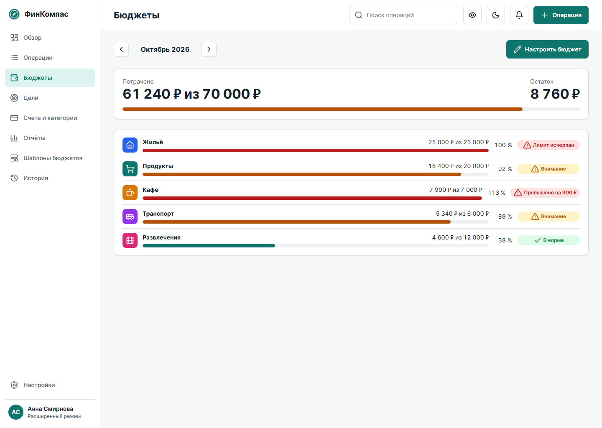

| Категория | Потрачено | Лимит | Использовано | Статус |
|---|---|---|---|---|
| Жильё | 25 000 ₽ | 25 000 ₽ | 100 % | Лимит исчерпан |
| Продукты | 18 400 ₽ | 20 000 ₽ | 92 % | Внимание |
| Кафе | 7 900 ₽ | 7 000 ₽ | 113 % | Превышено на 900 ₽ |
| Транспорт | 5 340 ₽ | 6 000 ₽ | 89 % | Внимание |
| Развлечения | 4 600 ₽ | 12 000 ₽ | 38 % | В норме |
| **Итого** | **61 240 ₽** | **70 000 ₽** | **87,5 %** | |

**Функционал:** переключатель месяца, настройка лимитов и порога, перенос остатка. В простом режиме показывается общая шкала. Цвет меняется на пороге и при 100 %, рядом всегда текстовый статус.

## S6. Отчёты и экспорт

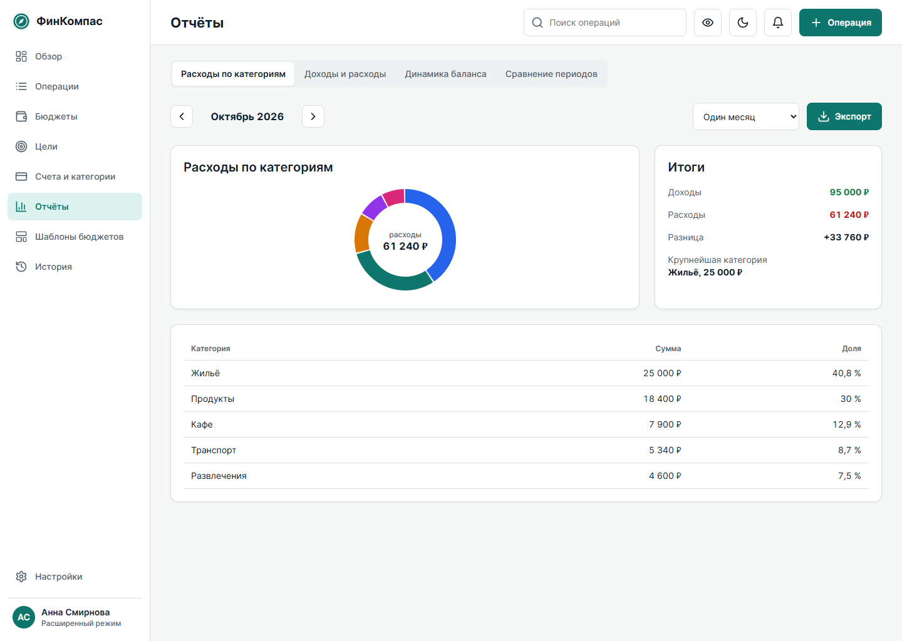

**Элементы:** вкладки расходов по категориям, доходов и расходов, динамики баланса и сравнения периодов, график, блок итогов, таблица, кнопка экспорта.

**Функционал:** CSV и XLSX формируются в браузере и скачиваются как настоящие файлы. PDF сохраняется через печать браузера.

## S7. История действий

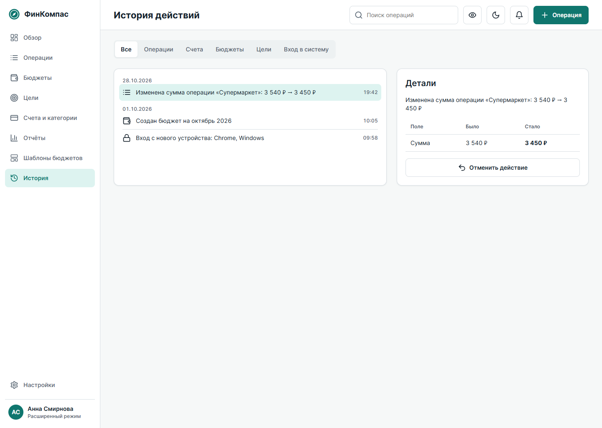

**Элементы:** фильтр по типу события, лента, блок «Было» и «Стало», кнопка отмены, «Это был не я».

**Функционал:** отмена создаёт новую запись и не стирает старую. События безопасности отменить нельзя.

## S8. Счета и категории

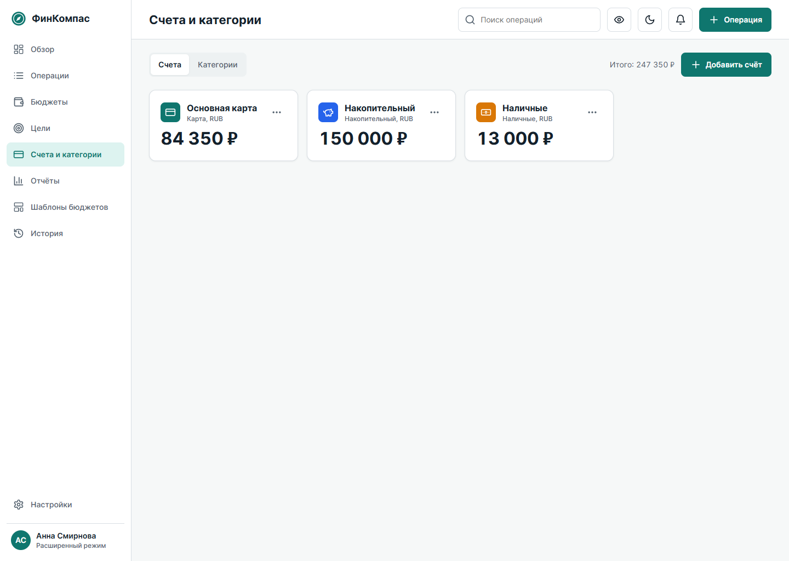

**Функционал:** добавление и изменение счетов, валюта счёта, учёт в общем балансе, категории. Счёт с операциями нельзя удалить молча: система предлагает перенести операции.

## S9. Финансовые цели

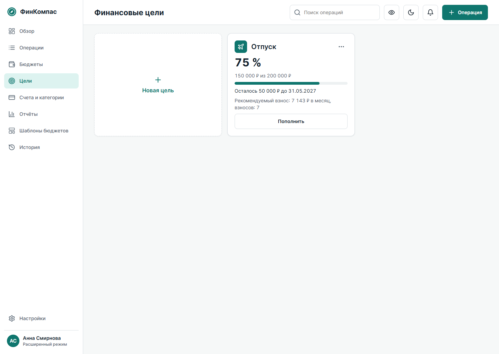

**Элементы карточки:** название, значок, 150 000 ₽ из 200 000 ₽, 75 %, срок 31.05.2027, рекомендуемый взнос 7 143 ₽ в месяц, кнопка «Пополнить».

**Функционал:** взнос пересчитывается при вводе. При 100 % показывается «Цель достигнута».

## S10. Смартфон

| Портрет | Альбомная ориентация |
|---|---|
| 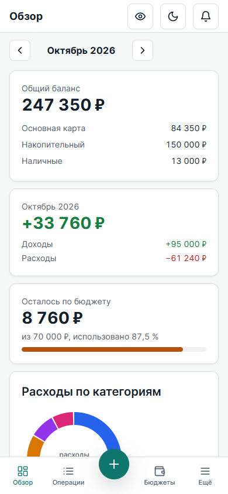 | 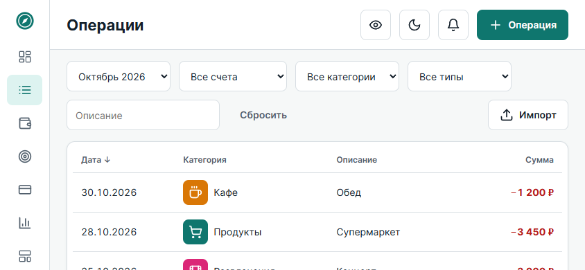 |

Нижняя панель: Обзор, Операции, центральная кнопка добавления, Бюджеты, Ещё. Правила адаптивности описаны в [responsive.md](responsive.md).

## S11. Шаблоны бюджетов

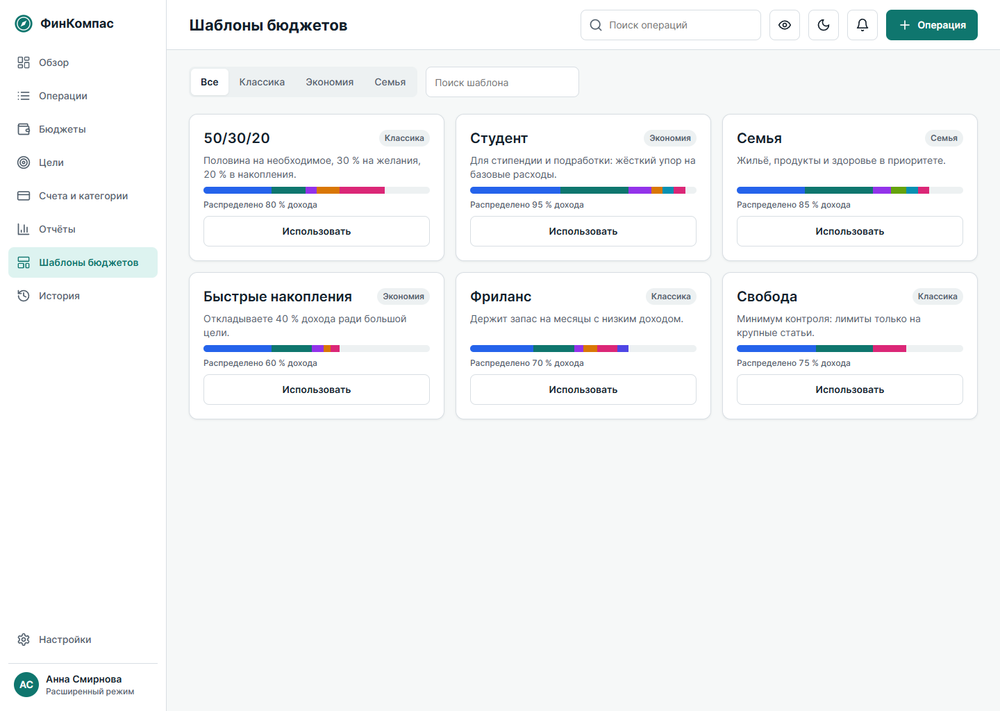

**Функционал:** поиск шаблона, расчёт лимитов от дохода, применение к выбранному месяцу.

## S12. Администрирование

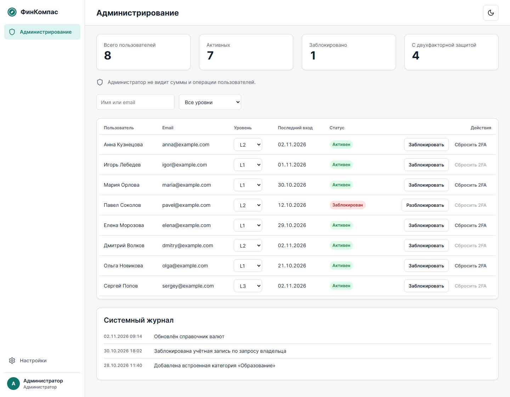

**Элементы:** таблица пользователей с уровнем и последним входом, блокировка, сброс 2FA, системный журнал.

**Функционал:** администратор не видит суммы и операции, обзор финансов для него закрыт.

## Планшет и состояния

Планшетные фреймы 834×1194 px сделаны для S2, S4, S5 и S6 в обеих темах: `*_Tablet_Light.svg`, `*_Tablet_Dark.svg`.

| Файл | Состояние |
|---|---|
| `ST_Login_Error` | Ошибка входа |
| `ST_Empty_Overview` | Обзор без операций |
| `ST_Add_Operation` | Форма новой операции |
| `ST_Form_Error` | Ошибка у поля формы |
| `ST_Undo_Toast` | Операция сохранена, можно отменить |
| `ST_Import_Preview` | Предпросмотр импорта |
| `ST_Budget_Empty` | На месяц нет бюджета |
| `ST_Budget_Setup` | Настройка бюджета |
| `ST_Export` | Выбор формата экспорта |
| `ST_Mobile_Sheet` | Нижний лист на смартфоне |

Каждое состояние есть в светлой и тёмной темах и в финальной схеме `Prototype_ST_*`.

# 8. Анимация

Анимация подчёркивает смысл действий и не задерживает работу. Базовая кривая `ease-out`. При системной настройке `prefers-reduced-motion` движение отключается.

## 8.1. Реализовано в приложении

Таблица соответствует `site/assets/css/app.css`.

| Анимация | Где | Описание | Длительность |
|---|---|---|---|
| Заполнение шкалы (`grow`) | Бюджеты, цели | Шкала растёт слева направо | 400 мс |
| Затемнение фона (`fade`) | Диалоги | Фон плавно появляется | 240 мс |
| Появление диалога (`rise`) | Диалоги, уведомления | Элемент поднимается на 12 px | 240 мс |
| Таймер отмены (`shrink`) | Уведомление | Полоса сокращается, показывая время на отмену | 5000 мс |
| Скелетон (`shine`) | Загрузка | Блик бежит по блоку | Цикл |
| Наведение | Кнопки, меню | Плавная смена фона | 120 мс |
| Переключатель | Настройки | Ползунок сдвигается | 120 мс |

## 8.2. Спроектировано для дальнейшей разработки

| Анимация | Описание | Длительность |
|---|---|---|
| Вращение компаса | Стрелка логотипа делает оборот при запуске | 800 мс |
| Счётчик суммы | Баланс досчитывается до нового значения | 400 мс |
| Рост диаграммы | Кольцо рисуется по часовой стрелке | 500 мс |
| Монета в копилку | Точка летит к шкале цели при пополнении | 500 мс |
| Достижение цели | Короткая вспышка конфетти один раз | 900 мс |

Видеоролики анимации не записывались: в интерфейсе только стандартные переходы, которые описаны таблицей и работают в прототипе.

# 9. Материалы для разработчиков

## 9.1. Состав

| Материал | Что входит | Где |
|---|---|---|
| Иконки | 57 значков Lucide, 24 px | `assets/icons/` |
| Спрайт | 57 значков одним файлом, `<symbol>` | `assets/sprite/sprite.svg` |
| Шрифт со значками | Lucide 0.460, WOFF2 и CSS | `assets/iconfont/` |
| Логотип | Векторный знак | `assets/logo/` |
| Шрифт | Inter 400, 500, 600, 700, кириллица и латиница | `assets/fonts/` |
| Токены | Цвет, типографика, отступы, радиусы, движение | `tokens/` |
| Макеты | 102 SVG и 102 PNG | `design/export/` |
| PDF | Отчёт, макеты и диаграммы | `design/export/` |
| Спецификация адаптивности | Брейкпоинты и поведение | [responsive.md](responsive.md) |
| Спецификация анимации | Таблица движения | [08-motion.md](08-motion.md) |
| Рабочий прототип | Приложение на HTML, CSS и JS | `site/` |

Приложение подключает значки как SVG. Спрайт и шрифт нужны разработчикам другой платформы. Шрифт взят из пакета Lucide 0.460 и содержит весь набор, поэтому названия и начертания могут немного отличаться от файлов в `assets/icons/`, собранных из версии 0.400.

## 9.2. Именование

- файлы макетов: `S2_Overview_Light.svg`, `S2_Overview_Dark.svg`;
- значки: `icon_wallet_24.svg`;
- токены: `state/income`, `accent/primary`;
- переменные CSS: `--accent`, `--text-1`, `--bg-surface`.

## 9.3. Файл Figma

Макеты загружены в файл [ФинКомпас в Figma](https://www.figma.com/design/13cyrQG2Ir2gv4kGTFjgeG): 102 фрейма из SVG с редактируемым текстом шрифтом Inter. Бесплатный тариф допускает 3 страницы, поэтому разделы оформлены секциями внутри страниц:

| Страница | Содержимое |
|---|---|
| Дизайн | Обложка и moodboard, UI-киты, экраны в светлой и тёмной темах, планшет, состояния |
| Диаграммы | UML Use-Case, User Flow Map, 4 листа User Flow |
| Прототипы | Черновые прототипы, финальные прототипы |

Фреймы являются импортированной векторной графикой: компоненты и Variables в файле не созданы. Значения токенов находятся в `tokens/tokens.json`.

Чтобы повторить импорт:

1. Установить шрифт Inter из `assets/fonts/` или из Google Fonts.
2. В Figma выбрать File, Import либо перетащить SVG на холст.

Figma не поддерживает маркеры линий и неверно отрисовывает штриховые дуги, поэтому `tools/svg-safe.mjs` при экспорте заменяет их обычными контурами.

## 9.4. Передача через Zeplin и аналоги

**Zeplin**

1. Установить плагин Zeplin в Figma.
2. Создать проект типа Web с плотностью @1x.
3. Выделить фреймы и выбрать экспорт в Zeplin.
4. Настроить Styleguide: цвета, текстовые стили, компоненты.
5. Отметить ассеты как Exportable.
6. Пригласить разработчиков и оставить комментарии к сложным местам.

**Аналоги**

- Figma Dev Mode: отступы, CSS и ассеты в самом файле, нужен платный тариф.
- Просмотр по ссылке: базовые свойства бесплатно, для учебной работы достаточно.
- Рабочий `site/` в этом репозитории: разработчик видит настоящий HTML и CSS, а значения берёт из токенов.

В этой работе Zeplin не подключался, передача выполнена через репозиторий.

## 9.5. Запуск и пересборка

Прототип открывается без сборки, но для экспорта нужны Node.js и Chrome. Папка из `PUPPETEER_DIR` должна содержать `node_modules` с `puppeteer-core`.

```bash
node tools/build-pages.mjs
```

```bash
node tools/test-app.mjs
```

```bash
node tools/export.mjs
```

# Доступность

Цель: WCAG 2.1, уровень AA. Значения контраста рассчитаны по формуле WCAG из `tokens/tokens.json`.

| Пара | Светлая | Тёмная | Норма |
|---|---|---|---|
| Основной текст на карточке | 16.52 | 13.74 | 4.5 |
| Основной текст на странице | 15.50 | 15.67 | 4.5 |
| Вторичный текст на карточке | 6.46 | 7.30 | 4.5 |
| Вторичный текст на странице | 6.06 | 8.33 | 4.5 |
| Вторичный текст на приглушённом фоне | 5.68 | 6.27 | 4.5 |
| Текст на акцентной кнопке | 5.47 | 9.94 | 4.5 |
| Акцент на карточке | 5.47 | 8.72 | 4.5 |
| Доход на карточке | 5.02 | 9.32 | 4.5 |
| Расход на карточке | 6.47 | 5.87 | 4.5 |
| Предупреждение на карточке | 5.02 | 9.73 | 4.5 |
| Информация на карточке | 6.70 | 6.39 | 4.5 |
| Бейдж расхода | 5.30 | 5.40 | 4.5 |
| Бейдж предупреждения | 4.51 | 8.11 | 4.5 |
| Бейдж дохода | 4.57 | 7.73 | 4.5 |

## Правила

- Цвет дублируется знаком «+» и «−» или текстовым статусом.
- Зоны нажатия не меньше 44 px, кроме малой кнопки 32 px в UI-ките и отдельных плотных строк.
- Поля подписаны, ошибки показаны у поля.
- При `prefers-reduced-motion` анимация отключается.
- Значки декоративны, кнопки только со значком имеют `aria-label`.

## Что не проверялось

Проверка программой чтения с экрана и полная проверка клавиатурной навигации не проводились. Цвета диаграмм и значков категорий в расчёт контраста не входят.

# Контент и тексты

## Голос продукта

Спокойный, точный, без укоров. Система сообщает факт и предлагает действие.

| Вместо | Пишем |
|---|---|
| Вы превысили бюджет! | Превышено на 900 ₽ |
| Ошибка ввода | Введите сумму больше нуля |
| Данные отсутствуют | Здесь появится ваша финансовая картина |
| Успешно! | Операция сохранена |

## Форматы

| Что | Формат | Пример |
|---|---|---|
| Сумма | Пробел между разрядами, знак валюты через пробел | 247 350 ₽ |
| Доход и расход | Знак всегда виден | +95 000 ₽, −61 240 ₽ |
| Процент | Запятая, пробел перед знаком | 87,5 % |
| Дата | ДД.ММ.ГГГГ | 30.10.2026 |
| Месяц | Полное название и год | Октябрь 2026 |

## Кнопки

Кнопка называет действие глаголом или объектом: «Сохранить», «Пополнить», «Импортировать». В диалогах подтверждения кнопка повторяет действие, а не говорит «ОК».

# Адаптивность

Значения соответствуют `site/assets/css/app.css`.

| Параметр | Desktop, от 1101 px | Tablet, 768–1100 px | Смартфон, до 767 px |
|---|---|---|---|
| Базовый макет | 1440×1024 | 834×1194 | 390×844 и 844×390 |
| Навигация | Боковое меню 240 px | Панель значков 72 px | Нижняя панель, 5 пунктов |
| Сетка | 12 колонок | 8 колонок | 1 колонка |
| Промежуток | 24 px | 16 px | 12 px |
| Поля контента | 32 px | 24 px | 16 px |
| Диалоги | По центру, 480 px | По центру, 480 px | Нижний лист |
| Таблицы | Полная таблица | Сокращённая | Карточки |
| Добавление операции | Кнопка в верхней панели | Кнопка в верхней панели | Центральная кнопка внизу |

Нижняя панель: Обзор, Операции, добавление, Бюджеты, Ещё.

Отдельные фреймы выгружены для desktop и смартфона (S10). Планшетная вёрстка реализована в `site/`: её видно, если открыть приложение при ширине 834 px.

## Проверка

`tools/test-app.mjs` подтверждает, что на ширине 360 px на девяти страницах нет горизонтальной прокрутки, а на 834 px её нет на трёх самых плотных страницах.

На настоящих телефонах интерфейс не проверялся, только эмуляцией размера в Chrome.

# 10. Отчёт и сдача

**Цель работы:** приобрести навыки проектирования пользовательского интерфейса программной системы на всех этапах, от технического задания до передачи макетов в разработку.

## 10.1. Структура итогового PDF

Итоговый файл: [FinKompas_Otchet.pdf](../design/export/FinKompas_Otchet.pdf). Шаблон отчёта из методички дан ссылкой и не использовался, поэтому структура рабочая:

1. Титульный лист.
2. Содержание.
3. Цель работы.
4. Техническое задание.
5. Исследование.
6. Сценарии и Use-Case диаграмма.
7. User Flow и User Flow Map.
8. Прототипы.
9. Moodboard и UI-киты.
10. Экраны.
11. Анимация.
12. Материалы для разработчиков.
13. Заключение.
14. Ссылки на Figma и GitHub.

## 10.2. Векторный PDF

- [FinKompas_Otchet.pdf](../design/export/FinKompas_Otchet.pdf): текст отчёта и все материалы одним файлом.
- [FinKompas_Makety.pdf](../design/export/FinKompas_Makety.pdf): обложка, moodboard, прототипы, UI-киты, экраны, планшет и состояния в двух темах.
- [FinKompas_Diagrammy.pdf](../design/export/FinKompas_Diagrammy.pdf): UML Use-Case, User Flow Map и 4 листа User Flow формата А4.

Текст в PDF векторный и выделяется курсором. Файлы собраны через Chrome из SVG (`tools/export.mjs`, `tools/build-report.mjs`).

Файл Figma: https://www.figma.com/design/13cyrQG2Ir2gv4kGTFjgeG

## 10.3. Что сделать перед сдачей

- [ ] Заполнить поля в квадратных скобках: группа, преподаватель, даты.
- [x] Импортировать SVG в Figma и добавить ссылку на файл.
- [ ] Открыть доступ к файлу Figma по ссылке (Share, Anyone with the link).
- [ ] Приложить снимки актуальных версий приложений-конкурентов.
- [ ] Сверить отчёт с шаблоном из методички.

## 10.4. Проверочный список

- [x] Экранов больше 8, есть регистрация и главный экран.
- [x] Есть светлый и тёмный UI-киты.
- [x] Use-Case диаграмма и User Flow Map есть, карта умещается на листе А4.
- [x] В User Flow Map выполнены все 8 элементов.
- [x] Прототипы сделаны для всех экранов, состояния оформлены в двух темах.
- [x] В отчёте собраны все материалы в векторном виде.
- [x] PDF векторный.
- [x] Репозиторий содержит серию коммитов.

## 10.5. Заключение

В ходе работы спроектирован интерфейс системы управления личными финансами «ФинКомпас». Разработано техническое задание с ролевой моделью, проведено аналитическое исследование аудитории и конкурентов, описаны 12 пользовательских сценариев, построены Use-Case диаграмма, User Flow и User Flow Map. Созданы черновые и финальные прототипы всех экранов, три варианта moodboard, светлый и тёмный UI-киты, 12 экранов в двух темах с планшетными фреймами и состояниями, описана анимация и подготовлены материалы для разработчиков. Дополнительно собран рабочий прототип в браузере, который прошёл 54 автоматические проверки.

# 11. Приложения

## Демонстрационные данные

| Показатель | Значение |
|---|---|
| Основная карта | 84 350 ₽ |
| Накопительный | 150 000 ₽ |
| Наличные | 13 000 ₽ |
| Общий баланс | 247 350 ₽ |
| Доходы за октябрь 2026 | 95 000 ₽ |
| Расходы за октябрь 2026 | 61 240 ₽ |
| Разница | +33 760 ₽ |
| Бюджет | 70 000 ₽, остаток 8 760 ₽ |
| Цель «Отпуск» | 150 000 ₽ из 200 000 ₽, взнос 7 143 ₽ × 7 |

Все имена и суммы вымышлены.

## Границы прототипа

Прототип работает только в браузере. Вход, код подтверждения, 2FA, сеансы и письма демонстрационные, данные хранятся в `localStorage` и никуда не передаются. Курсы валют постоянные. Подключение к банкам не реализовано.

## Лицензии

| Компонент | Лицензия |
|---|---|
| Код и материалы проекта | MIT |
| Значки Lucide | ISC |
| Шрифт Inter | SIL Open Font License 1.1 |

## Использованные источники

1. WCAG 2.1. Web Content Accessibility Guidelines. W3C.
2. Документация UML: диаграммы вариантов использования. OMG.
3. Документация Lucide. lucide.dev.
4. Документация Inter. rsms.me/inter.
