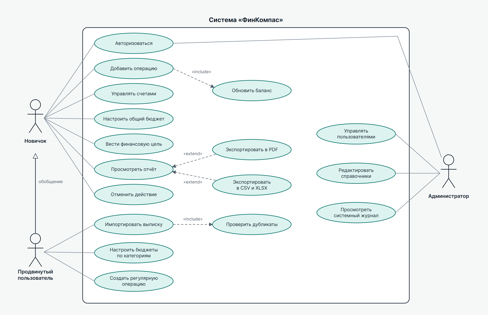

# 3. Пользовательские сценарии

## 3.1. Список задач

| № | Задача | Роль | Экран |
|---|---|---|---|
| 1 | Регистрация и первичная настройка | Гость | S1 |
| 2 | Добавление операции | Новичок | S2, S4 |
| 3 | Создание счёта | Новичок | S8 |
| 4 | Импорт банковской выписки | Продвинутый | S4 |
| 5 | Настройка бюджета | Продвинутый | S5 |
| 6 | Применение шаблона бюджета | Новичок | S11 |
| 7 | Создание и пополнение цели | Новичок | S9 |
| 8 | Просмотр и экспорт отчёта | Продвинутый | S6 |
| 9 | Отмена ошибочного действия | Новичок | S7 |
| 10 | Смена темы и режима | Новичок | S3 |
| 11 | Завершение чужого сеанса | Новичок | S3, S7 |
| 12 | Блокировка учётной записи | Администратор | S12 |

## 3.2. Описание по шагам

**Задача 1. Регистрация и первичная настройка**

1. Открыть приложение, выбрать вкладку «Регистрация».
2. Ввести имя, email и пароль, принять условия обработки данных.
3. Ввести код подтверждения.
4. Выбрать валюту и режим: простой или расширенный.
5. Указать остаток первого счёта.
6. Попасть на обзор с пустым состоянием и кнопкой «Добавить первую операцию».

**Задача 2. Добавление операции**

1. Нажать «Операция».
2. Выбрать тип: расход, доход или перевод. По умолчанию выбран расход.
3. Ввести сумму.
4. Выбрать категорию.
5. При необходимости изменить счёт и дату, добавить комментарий.
6. Нажать «Сохранить». Появится уведомление с кнопкой «Отменить», баланс и бюджет обновятся.

**Задача 3. Создание счёта**

1. Открыть «Счета и категории».
2. Нажать кнопку добавления счёта.
3. Указать название, валюту и начальный остаток.
4. Сохранить. Счёт появится в списке.

**Задача 4. Импорт банковской выписки**

1. Открыть «Операции», нажать «Импорт».
2. Выбрать файл CSV или OFX.
3. Выбрать счёт.
4. Сопоставить колонки файла с полями системы.
5. Проверить предпросмотр: строки отмечены как новые, дубликаты или ошибки.
6. Нажать «Импортировать» и увидеть итог: сколько добавлено и сколько пропущено.

**Задача 5. Настройка бюджета**

1. Открыть «Бюджеты», выбрать месяц.
2. Нажать кнопку настройки.
3. Задать лимиты по категориям.
4. Выбрать порог уведомления, по умолчанию 80 %.
5. Нажать «Сохранить бюджет» и увидеть прогресс по категориям.

**Задача 6. Применение шаблона бюджета**

1. Открыть «Шаблоны бюджетов».
2. Выбрать шаблон и нажать «Использовать».
3. Указать месячный доход.
4. Нажать «Применить». Система рассчитает лимиты и откроет бюджет.

**Задача 7. Создание и пополнение цели**

1. Открыть «Цели», нажать кнопку создания.
2. Ввести название, сумму и срок.
3. Система рассчитает ежемесячный взнос.
4. Нажать «Пополнить» и ввести сумму.

**Задача 8. Просмотр и экспорт отчёта**

1. Открыть «Отчёты».
2. Выбрать вкладку и период.
3. Изучить график и итоги.
4. Нажать кнопку экспорта, выбрать PDF, CSV или XLSX.
5. Получить файл. PDF сохраняется через печать браузера.

**Задача 9. Отмена ошибочного действия**

1. Открыть «История».
2. Найти событие с помощью фильтра.
3. Посмотреть блок «Было» и «Стало».
4. Нажать кнопку отмены и подтвердить.
5. Данные вернутся, в истории появится новая запись.

**Задача 10. Смена темы и режима**

1. Открыть «Настройки», раздел «Оформление».
2. Выбрать тему и режим. Изменения применяются сразу.

**Задача 11. Завершение чужого сеанса**

1. В разделе безопасности найти незнакомое устройство в списке активных.
2. Нажать «Завершить сеанс» или кнопку «Это был не я» в истории.
3. Сменить пароль.

**Задача 12. Блокировка учётной записи**

1. Войти как администратор. Обзор финансов недоступен, открывается раздел администрирования.
2. Найти пользователя в таблице.
3. Нажать кнопку блокировки. В системном журнале появится запись.

## 3.3. UML Use-Case диаграмма

Вектор: [UML_UseCase.svg](../design/export/svg/UML_UseCase.svg). Обобщение показывает, что продвинутый пользователь наследует всё, что доступно новичку.
