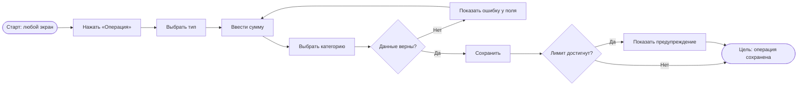
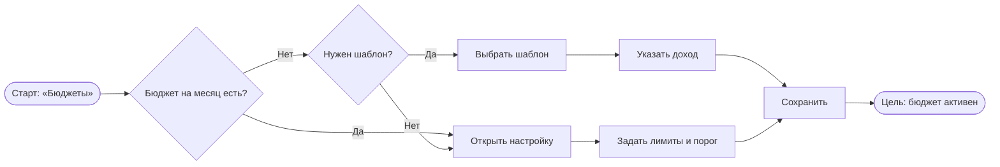
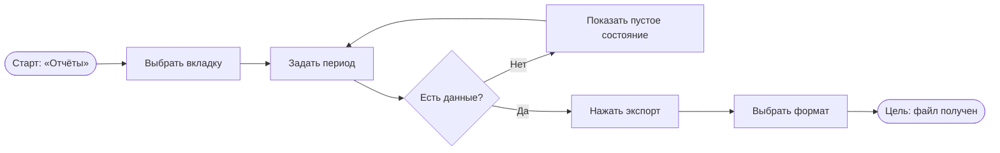
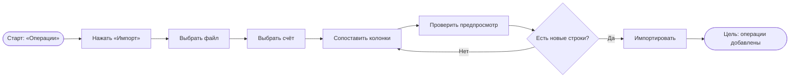
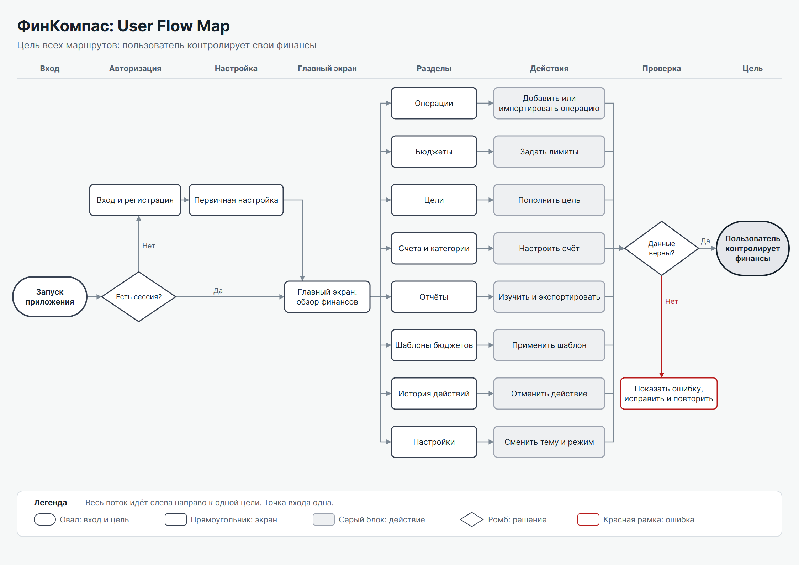

# 4. Структура интерфейса

## 4.1. Информационная архитектура

```text
Вход и регистрация (S1)
└── Обзор (S2)
    ├── Операции (S4)
    │   ├── Форма операции
    │   ├── Импорт выписки
    │   └── Регулярные платежи
    ├── Бюджеты (S5)
    ├── Цели (S9)
    ├── Счета и категории (S8)
    ├── Отчёты (S6)
    │   └── Экспорт
    ├── Шаблоны бюджетов (S11)
    ├── История (S7)
    └── Настройки (S3)

Администрирование (S12): отдельная ветка для роли администратора
```

## 4.2. User Flow ключевых сценариев

**Сценарий 1. Добавление операции.** Цель: операция сохранена, баланс обновлён.



**Сценарий 2. Настройка бюджета.** Цель: бюджет на месяц создан.



**Сценарий 3. Экспорт отчёта.** Цель: пользователь получил файл.



**Сценарий 4. Импорт выписки.** Цель: операции добавлены без дублей.



## 4.3. User Flow Map всего приложения



Лист А4, альбомная ориентация: [FinKompas_Diagrammy.pdf](../design/export/FinKompas_Diagrammy.pdf).

| № | Элемент | Реализация |
|---|---|---|
| 1 | Название | Заголовок листа: «ФинКомпас: User Flow Map» |
| 2 | Одно направление | Поток идёт слева направо |
| 3 | Одна цель | Единственная финальная точка: «Пользователь контролирует финансы» |
| 4 | Легенда | Внизу листа: экран, действие, решение, цель, ошибка |
| 5 | Точка входа | Единственная точка слева: «Запуск приложения» |
| 6 | Подписи | Каждый блок подписан, ветвления отмечены «Да» и «Нет» |
| 7 | Цвета | Бирюзовый: экраны. Синий: действия. Жёлтый: решения. Зелёный: цель. Красный: ошибки |
| 8 | Проверка цели | Из каждого блока можно пройти к цели, тупиков нет |
