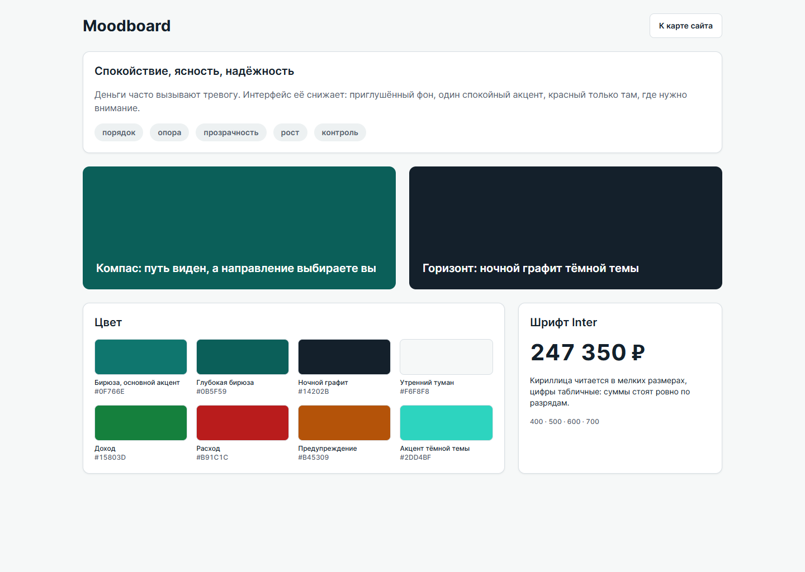
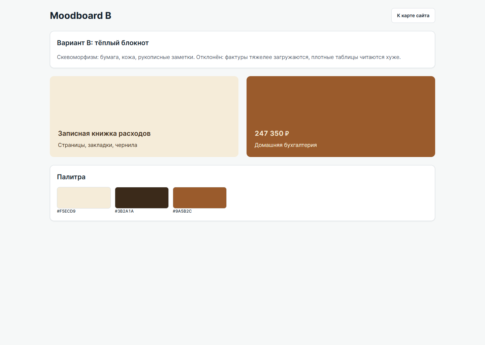
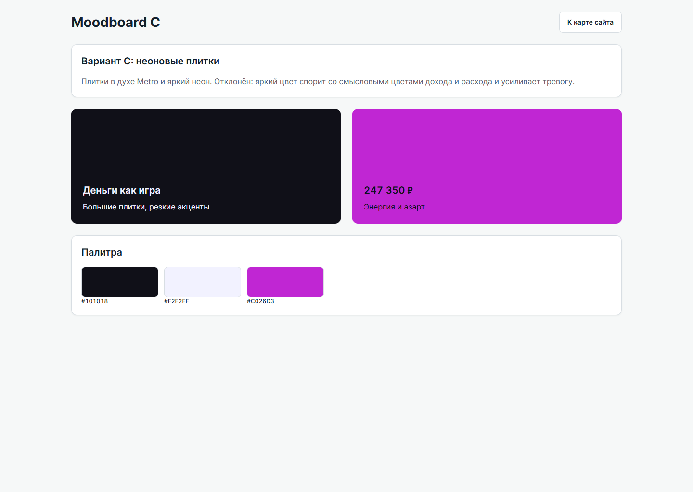
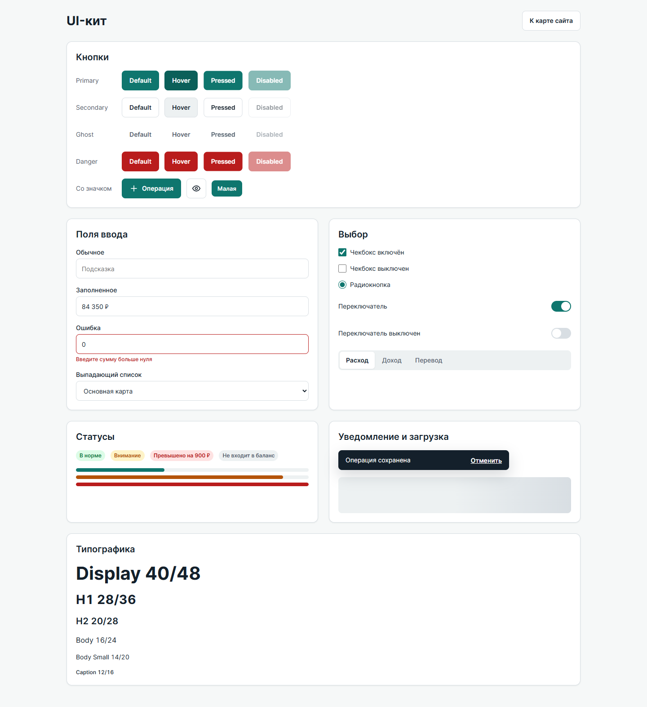
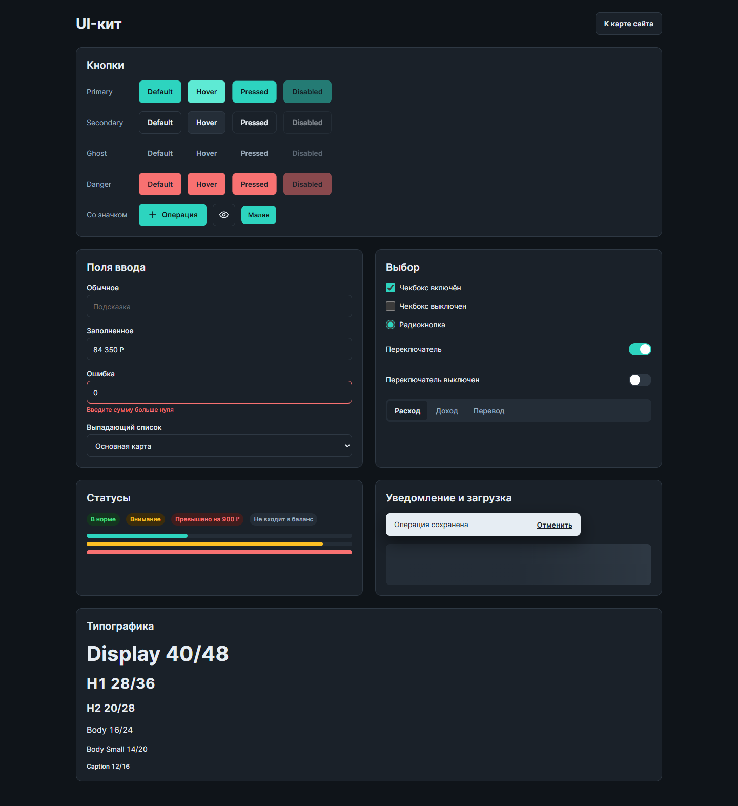

# 6. Стилистика

## 6.1. Moodboard

**Настроение:** спокойствие, ясность, надёжность. Деньги и так вызывают тревогу, поэтому красный используется только там, где нужно внимание.

**Ключевые слова:** порядок, опора, прозрачность, рост, контроль.

**Метафора:** компас. Он не идёт за пользователя, но показывает, где тот находится и куда двигаться.

### Сравнение вариантов

Рассмотрено три набора:

| Вариант | Стиль | Решение |
|---|---|---|
| A, компас | Плоский, близок к Material: поверхности, мягкие тени, сетка 8 px | Выбран: плотные таблицы читаются легко, цвет работает только на смысл |
| B, блокнот | Скевоморфизм: бумага, кожа | Отклонён: фактуры мешают данным и дороже в загрузке |
| C, плитки | Metro: большие плитки, неон | Отклонён: яркий акцент спорит с цветами дохода и расхода |

### Гармония цвета

Схема контрастная: глубокий бирюзовый акцент и красный лежат на круге Иттена почти напротив друг друга. Поэтому расход сразу заметен на спокойном фоне, а основную часть экрана занимают нейтральные серые тона.

## 6.2. Типографика

Шрифт Inter: есть кириллица, хорошая читаемость в мелких размерах, табличные цифры.

| Стиль | Размер / межстрочный | Насыщенность | Применение |
|---|---|---|---|
| Display | 40 / 48 | 700 | Общий баланс |
| H1 | 28 / 36 | 700 | Заголовок раздела |
| H2 | 20 / 28 | 600 | Заголовок карточки |
| Body | 16 / 24 | 400 | Основной текст |
| Body Small | 14 / 20 | 400 | Таблицы, подписи |
| Caption | 12 / 16 | 500 | Метки графиков |

## 6.3. Токены цвета

| Токен | Светлая | Тёмная | Назначение |
|---|---|---|---|
| `bg/page` | `#F6F8F8` | `#0F1419` | Фон страницы |
| `bg/surface` | `#FFFFFF` | `#1A2129` | Карточки, панели |
| `bg/muted` | `#EDF1F2` | `#242D37` | Приглушённый фон |
| `border/default` | `#D8DEE3` | `#2E3843` | Границы |
| `text/primary` | `#14202B` | `#E6EDF3` | Основной текст |
| `text/secondary` | `#52606D` | `#9FB0C0` | Вторичный текст |
| `accent/primary` | `#0F766E` | `#2DD4BF` | Основные действия |
| `accent/on-primary` | `#FFFFFF` | `#0F1419` | Текст на акцентной кнопке |
| `state/income` | `#15803D` | `#4ADE80` | Доход |
| `state/expense` | `#B91C1C` | `#F87171` | Расход, ошибка |
| `state/warning` | `#B45309` | `#FBBF24` | Приближение к лимиту |
| `state/info` | `#1D4ED8` | `#60A5FA` | Информация |

Полный набор: [tokens.json](../tokens/tokens.json), [tokens.css](../tokens/tokens.css).

## 6.4. UI-киты

| Светлый | Тёмный |
|---|---|
|  |  |

Параметры: радиус карточек 12 px, кнопок и полей 8 px, высота кнопок и полей 44 px, значки Lucide.

| Группа | Компоненты | Состояния |
|---|---|---|
| Кнопки | Primary, Secondary, Ghost, Danger, со значком | Default, Hover, Pressed, Disabled |
| Поля | Текст, сумма, выпадающий список | Обычное, заполненное, ошибка |
| Выбор | Чекбокс, радиокнопка, переключатель, сегменты | Включено, выключено |
| Статусы | Бейджи, шкалы прогресса | В норме, внимание, превышено |
| Обратная связь | Уведомление, скелетон | Успех, загрузка |

## 6.5. Тёмная тема

Зачем она финансовой системе:

- учёт часто ведут вечером, тёмный фон меньше утомляет глаза;
- на OLED-экранах тёмный интерфейс расходует меньше заряда;
- яркий экран в общественном месте привлекает внимание к личным данным.

Как устроена:

- глубина передаётся осветлением поверхности: страница `#0F1419`, карточка `#1A2129`;
- вместо чистых чёрного и белого используются смягчённые тона;
- смысловые цвета осветлены и остаются контрастными;
- на акцентной кнопке тёмный текст.

Тема переключается одной кнопкой в верхней панели и в настройках. Значения контраста приведены в [a11y.md](a11y.md).
