# 7. Оформление экранов

Данные едины для всех экранов и согласованы по суммам. Период: октябрь 2026. Каждый экран есть в светлой и тёмной темах: `design/export/svg/<код>_Light.svg` и `<код>_Dark.svg`.

## S1. Регистрация и авторизация

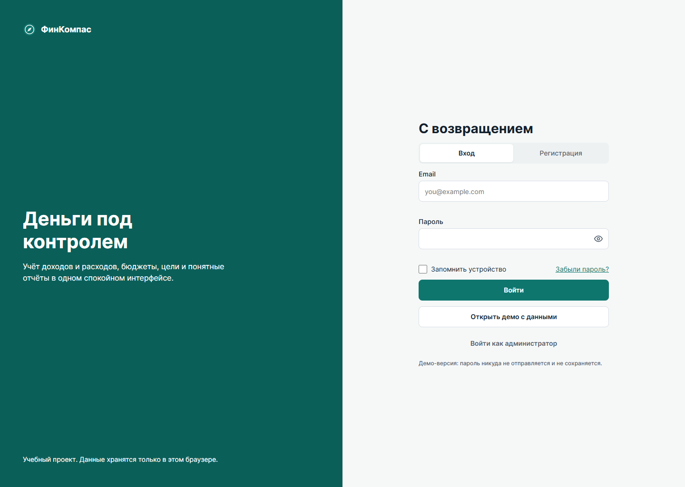

**Назначение:** вход и создание учётной записи.

**Элементы:** логотип и слоган «Деньги под контролем», вкладки «Вход» и «Регистрация», поля имени, email и пароля, индикатор надёжности пароля, «Запомнить устройство», согласие на обработку данных, «Забыли пароль?», вход в демо-версию и вход администратора.

**Функционал:** проверка полей, подтверждение кодом из 6 цифр, первичная настройка валюты, режима и остатка. Форма демонстрационная: пароль никуда не отправляется.

**Адаптивность:** на смартфоне блок описания скрыт, остаются логотип и форма.

## S2. Главный экран

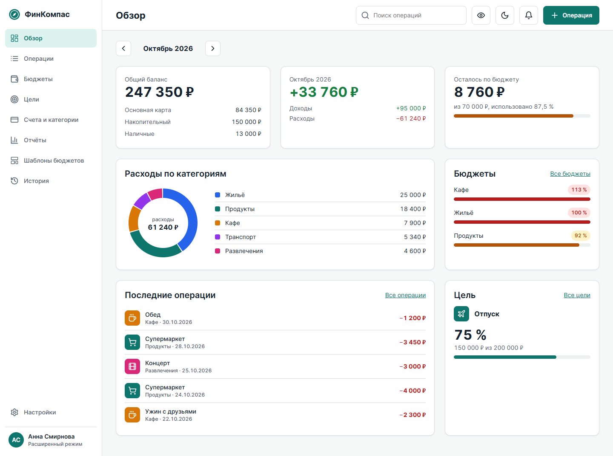

**Назначение:** показать финансовое состояние.

**Элементы:** общий баланс 247 350 ₽ со списком счетов; октябрь: доходы +95 000 ₽, расходы −61 240 ₽, разница +33 760 ₽; остаток бюджета 8 760 ₽ из 70 000 ₽, использовано 87,5 %; кольцевая диаграмма расходов; три бюджета, ближайшие к лимиту; пять последних операций; цель «Отпуск», 75 %.

**Функционал:** скрытие сумм, переключение месяца, пустое состояние с кнопкой «Добавить первую операцию».

**Адаптивность:** tablet: 8 колонок. Смартфон: одна колонка.

## S3. Настройки профиля

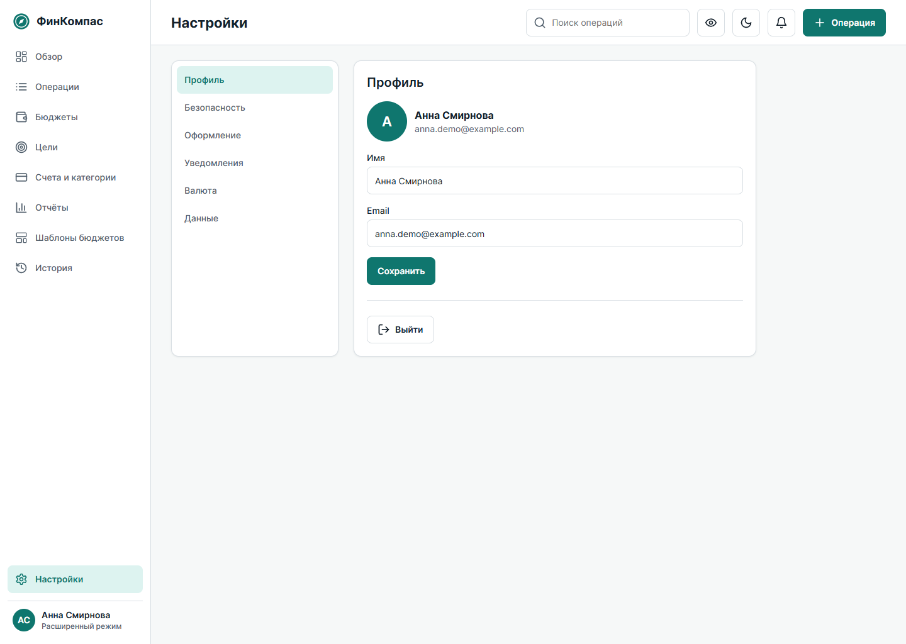

**Элементы:** профиль, безопасность (смена пароля, двухфакторная аутентификация, активные устройства), оформление (тема и режим), валюта с постоянными демо-курсами, данные (возврат демо-данных, удаление аккаунта).

**Функционал:** тема и режим применяются сразу. Удаление аккаунта требует подтверждения.

## S4. Операции

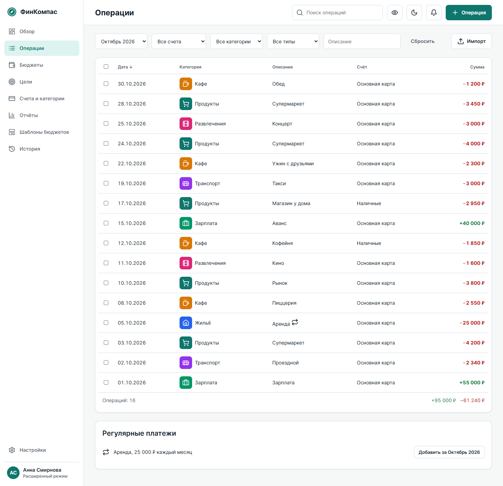

**Элементы:** фильтры по периоду, счёту, категории, типу и описанию, «Сбросить», «Импорт», таблица с датой, категорией, описанием, счётом и суммой, итог, регулярные платежи.

**Функционал:** сортировка, выбор строк, изменение категории и удаление нескольких операций, отмена через уведомление 5 секунд. Импорт идёт в 4 шага: файл CSV или OFX, счёт, сопоставление колонок, предпросмотр с дубликатами и ошибками.

**Адаптивность:** на смартфоне таблица становится списком карточек.

## S5. Бюджеты

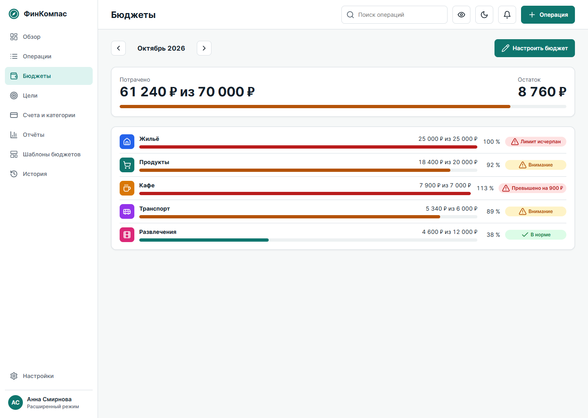

| Категория | Потрачено | Лимит | Использовано | Статус |
|---|---|---|---|---|
| Жильё | 25 000 ₽ | 25 000 ₽ | 100 % | Лимит исчерпан |
| Продукты | 18 400 ₽ | 20 000 ₽ | 92 % | Внимание |
| Кафе | 7 900 ₽ | 7 000 ₽ | 113 % | Превышено на 900 ₽ |
| Транспорт | 5 340 ₽ | 6 000 ₽ | 89 % | Внимание |
| Развлечения | 4 600 ₽ | 12 000 ₽ | 38 % | В норме |
| **Итого** | **61 240 ₽** | **70 000 ₽** | **87,5 %** | |

**Функционал:** переключатель месяца, настройка лимитов и порога, перенос остатка. В простом режиме показывается общая шкала. Цвет меняется на пороге и при 100 %, рядом всегда текстовый статус.

## S6. Отчёты и экспорт

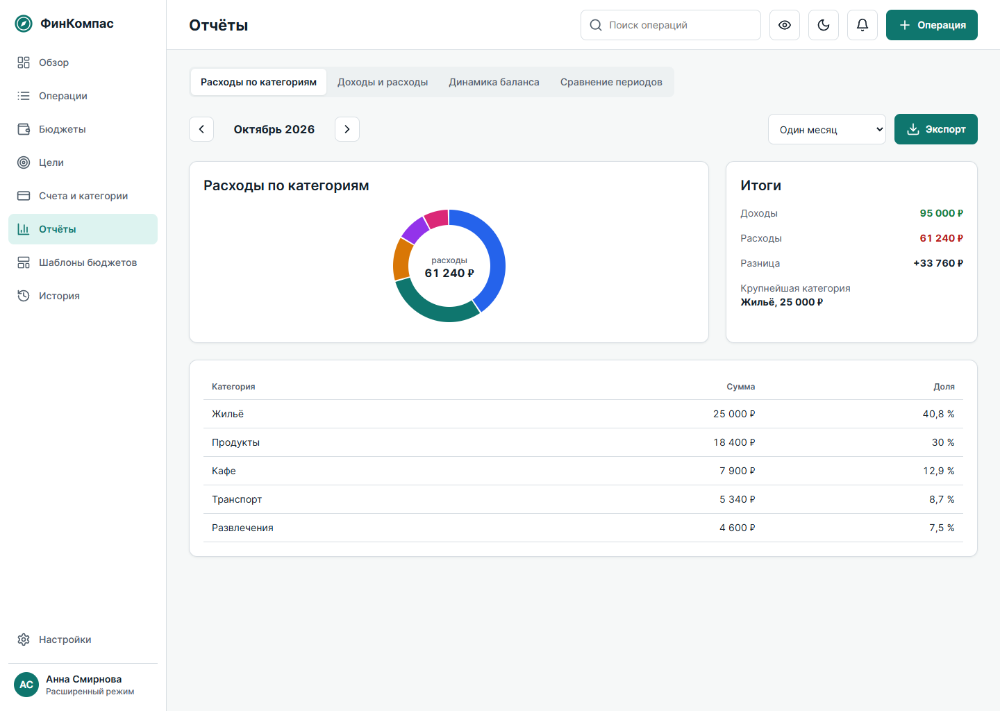

**Элементы:** вкладки расходов по категориям, доходов и расходов, динамики баланса и сравнения периодов, график, блок итогов, таблица, кнопка экспорта.

**Функционал:** CSV и XLSX формируются в браузере и скачиваются как настоящие файлы. PDF сохраняется через печать браузера.

## S7. История действий

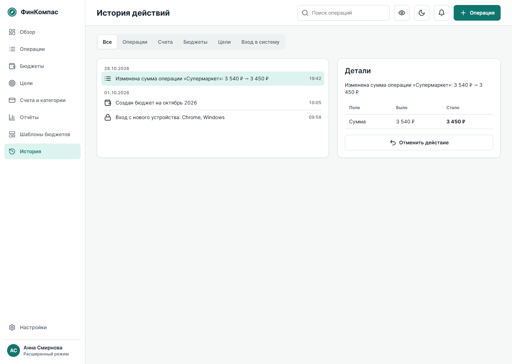

**Элементы:** фильтр по типу события, лента, блок «Было» и «Стало», кнопка отмены, «Это был не я».

**Функционал:** отмена создаёт новую запись и не стирает старую. События безопасности отменить нельзя.

## S8. Счета и категории

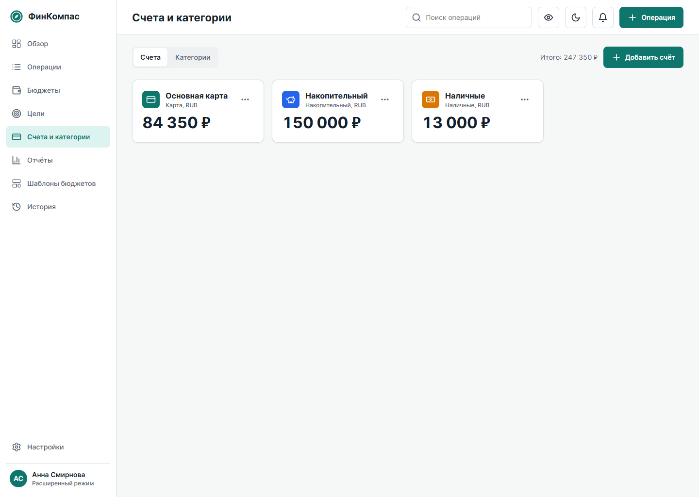

**Функционал:** добавление и изменение счетов, валюта счёта, учёт в общем балансе, категории. Счёт с операциями нельзя удалить молча: система предлагает перенести операции.

## S9. Финансовые цели

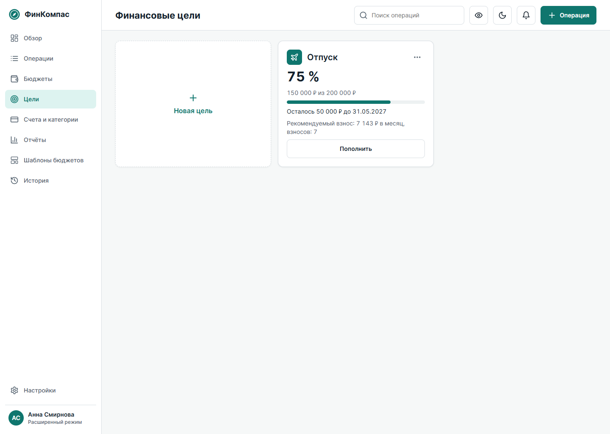

**Элементы карточки:** название, значок, 150 000 ₽ из 200 000 ₽, 75 %, срок 31.05.2027, рекомендуемый взнос 7 143 ₽ в месяц, кнопка «Пополнить».

**Функционал:** взнос пересчитывается при вводе. При 100 % показывается «Цель достигнута».

## S10. Смартфон

| Портрет | Альбомная ориентация |
|---|---|
| 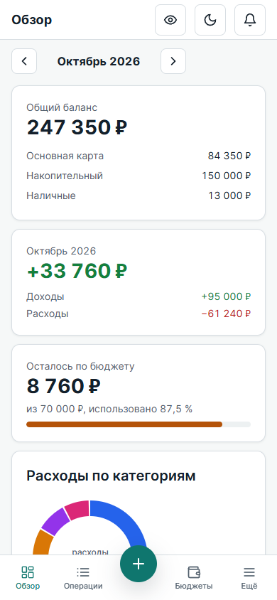 | 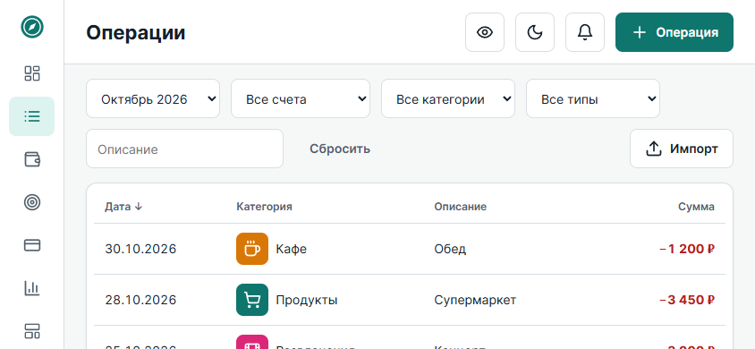 |

Нижняя панель: Обзор, Операции, центральная кнопка добавления, Бюджеты, Ещё. Правила адаптивности описаны в [responsive.md](responsive.md).

## S11. Шаблоны бюджетов

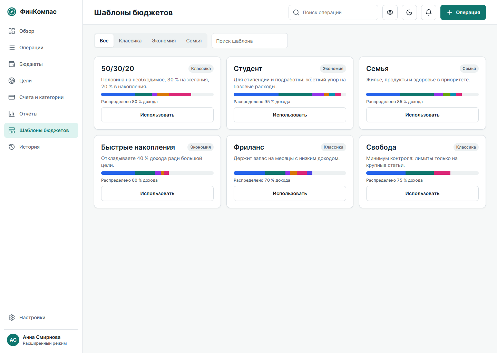

**Функционал:** поиск шаблона, расчёт лимитов от дохода, применение к выбранному месяцу.

## S12. Администрирование

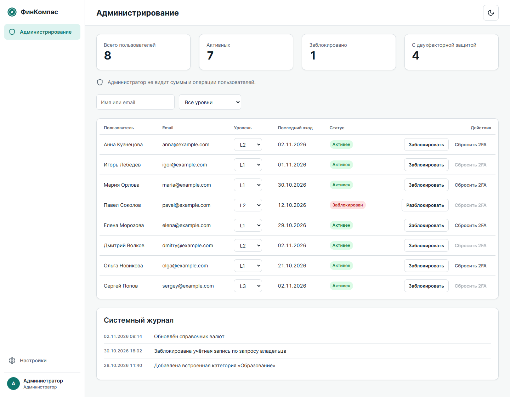

**Элементы:** таблица пользователей с уровнем и последним входом, блокировка, сброс 2FA, системный журнал.

**Функционал:** администратор не видит суммы и операции, обзор финансов для него закрыт.

## Планшет и состояния

Планшетные фреймы 834×1194 px сделаны для S2, S4, S5 и S6 в обеих темах: `*_Tablet_Light.svg`, `*_Tablet_Dark.svg`.

| Файл | Состояние |
|---|---|
| `ST_Login_Error` | Ошибка входа |
| `ST_Empty_Overview` | Обзор без операций |
| `ST_Add_Operation` | Форма новой операции |
| `ST_Form_Error` | Ошибка у поля формы |
| `ST_Undo_Toast` | Операция сохранена, можно отменить |
| `ST_Import_Preview` | Предпросмотр импорта |
| `ST_Budget_Empty` | На месяц нет бюджета |
| `ST_Budget_Setup` | Настройка бюджета |
| `ST_Export` | Выбор формата экспорта |
| `ST_Mobile_Sheet` | Нижний лист на смартфоне |

Каждое состояние есть в светлой и тёмной темах и в финальной схеме `Prototype_ST_*`.
